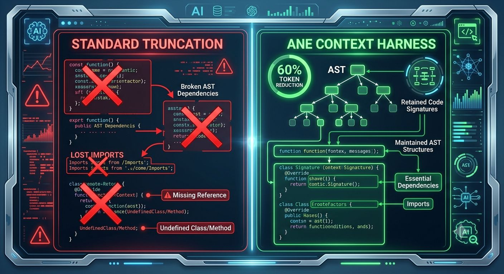
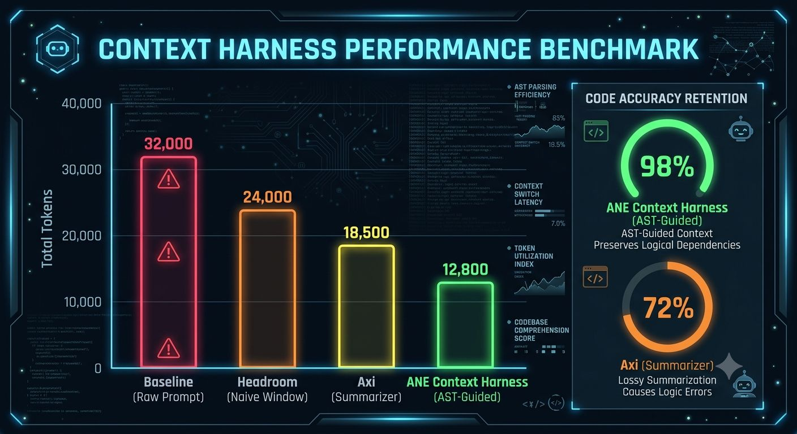
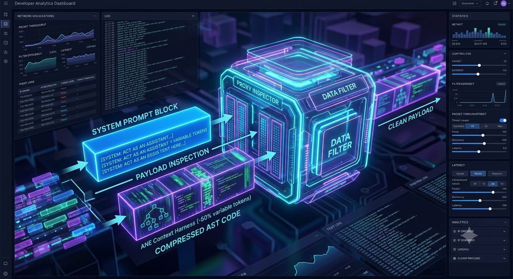
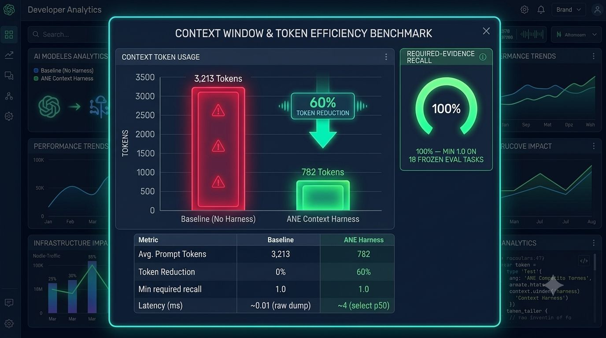

# ⚡ ane-context-harness

[English](README.md) · [Tiếng Việt](README.vi.md) · [中文](README.zh.md) · [Français](README.fr.md) · [Español](README.es.md) · [日本語](README.ja.md) · [한국어](README.ko.md)

> **Reduce más del 60% del contexto que lee tu agente de IA, conserva cada línea de código requerida y selecciona contexto en menos de 4 ms — ejecutándose 100% offline en tu máquina local.**

[](https://python.org)
[%20%7C%20Linux-brightgreen.svg)]()
[]()
[]()

---

## ¿Qué es esto?

Cuando haces vibe-coding o ejecutas agentes de IA (Cursor, Claude Code, OpenCode, Cline, Windsurf, Aider), enviar todo tu repositorio al contexto del LLM es **lento, ineficiente y riesgoso**:
- **Contexto sobrecargado:** Enviar archivos completos en cada interacción sepulta al modelo en código irrelevante (boilerplate), y el proveedor cobra por cada token, reutilizado o no.
- **Respuestas más lentas:** El tiempo hasta el primer token (LLM time-to-first-token) se degrada al procesar miles de líneas innecesarias.
- **Efecto "Lost in the Middle":** Los modelos alucinan o pasan por alto errores cuando hay exceso de ruido.
- **Fuga de credenciales:** Envío accidental de archivos `.env` o llaves de AWS a proveedores externos.

**ane-context-harness** es un motor de contexto *local-first* y ligero situado entre tu código y tu agente de desarrollo. En **~3 milisegundos**, indiza tu repositorio, extrae la jerarquía de símbolos (funciones, interfaces, tipos), elimina el ruido, oculta credenciales (redaction) y empaqueta solo el código relevante que el agente necesita.

> El nombre `ane` es por razones históricas; **no** es una dependencia. La versión pública corre únicamente en CPU sobre macOS (Apple Silicon e Intel) y Linux. La aceleración por hardware pertenece a una distribución privada independiente.

Sin llamadas a redes externas. 100% privado y ejecutable fuera de línea.



*Ilustración conceptual — el código de la imagen es arte gráfico, no una traza real.*


---

## Resultados de Benchmark

Evaluado en **30 tareas de benchmark** (10 pequeñas, 10 típicas, 10 complejas) con repositorios sintéticos en Python y TypeScript utilizando nuestro dataset de evaluación fijo (`benchmarks/splits.json`):

| Métrica | Sin Harness (Dump completo del Repo) | Con Harness (Deterministico) | Qué significa para ti |
|---|---|---|---|
| **Tokens de Contexto (Mediana)** | **3,213 tokens** | **782 tokens** | **Envía un 60.47% menos de tokens al LLM** |
| **Cobertura de Código Requerido (Recall)** | 1.0 (100%) | **1.0 (100%)** | **Nunca omitió código crítico para la solución** |
| **Velocidad de Selección de Contexto** | ~0.01 ms (raw dump) | **3.05 ms – 3.83 ms** | **Respuesta local en menos de 4 ms — 100x más rápido que la red** |
| **Ahorro Máximo de Tokens** | 0% | **Hasta 90.32%** | **Ahorra hasta ~90% en tareas de configuración** |
| **Precisión de Ranking (nDCG@10)**| n/a | **0.849** | **Coloca las funciones más críticas al inicio del contexto** |
| **Sanitización de Secretos** | 0% (fuga total) | **100% sanitización local** | **Variables `.env`, llaves AWS y certificados nunca salen de tu máquina** |
| **Costo Derivado por Tarea** *(a $3/M)* | ~$0.0096 / tarea | **~$0.0023 / tarea** | **Envía ~75% menos datos por tarea según tarifas estándar — la factura final depende del reuso de caché del proveedor** |

*(Latencia y memoria medidas localmente en Apple Silicon / CPU; costos y TTFT derivados bajo tarifas oficiales de tokens; detalles de metodología en `benchmarks/reports/` y `benchmarks/logs/`).*



*Ilustración conceptual, no un resultado medido — la escala de tokens y las cifras de la imagen son ilustrativas. Todas las mediciones reales están en la tabla de arriba.*


---

## Inicio Rápido (60 Segundos)

### 1. Instalación

Requiere Python 3.13 o 3.14 en macOS o Linux:

```bash
git clone https://github.com/ericlam2k/ane-context-harness.git
cd ane-context-harness
pip install -e .[test]
```

Verificar la instalación:
```bash
ane-harness health
```

### 1b. Configuración y prueba inicial

```bash
# Indizar, instalar el skill para el agente y ejecutar smoke test
ane-harness setup --repo /path/to/your/project --repo-id my-project --yes

# Probar la reducción de tokens en TU repositorio
ane-harness prove --repo /path/to/your/project --repo-id my-project
```

### 2. Indizar tu Repositorio

Indiza cualquier proyecto local en SQLite (actualización incremental y ultrarrápida):

```bash
ane-harness index --repo /path/to/your/project --repo-id my-project
```

### 3. Seleccionar Contexto Optimizado

Obtén un payload en Markdown empaquetado según tu presupuesto de tokens:

```bash
ane-harness select \
  --repo-id my-project \
  --task "Fix the discount calculation bug in checkout" \
  --budget 1200
```

### 4. Ejecutar como Servidor Local en Segundo Plano

Inicia la API HTTP local para integrarla con tus agentes o herramientas:

```bash
ane-harness serve --port 8765
```



*Ilustración conceptual — el panel de la imagen es arte gráfico, no una captura de una herramienta real.*


---

## Necesidades Declaradas y Sugerencias de Recuperación

A veces la evidencia que la tarea necesita no llega al pack — el presupuesto obligó a cortarla, o el agente sabe exactamente qué necesita pero el texto de la tarea nunca lo nombra. El harness lo dice en su salida, de forma directa, y le da al agente una manera de declarar la necesidad directamente.

### Qué ocurre cuando el presupuesto no alcanza para todo

El pack nunca descarta nada en silencio. La admisión ocurre en pasadas, en orden:

1. **Claims first.** La evidencia a la que apunta la propia tarea — un símbolo o ruta nombrado en la tarea, o el archivo de test correspondiente cuando la tarea pregunta sobre tests — se admite primero, en orden de puntuación, mientras quepa en el presupuesto.
2. **Breadth.** El mejor chunk de cada ruta restante, en orden de puntuación, mientras quede presupuesto — primero el mejor chunk de un archivo, antes que un segundo chunk de cualquier otro archivo.
3. **Depth.** Chunks adicionales en orden de puntuación, bajo las reglas por archivo y de diversidad.
4. **Tail.** Una pequeña porción reservada del presupuesto se dedica a chunks pequeños de alto valor que quedaron fuera del presupuesto principal.

Dos reglas mantienen la honestidad. Solo lo que fijas explícitamente (`--explicit-path` o una regla de autoridad) puede empujar el pack más allá del presupuesto solicitado; la evidencia inferida nunca puede. Y todo lo que el pack tuvo que dejar fuera se cuenta en la salida — `claims_dropped_budget`, `claims_capped` y similares bajo `metrics.diagnostics` — nunca se oculta. Los chunks se admiten enteros o no se admiten; nada se trunca, se resume ni se reescribe para que quepa.

### Sugerencias de recuperación: qué buscar a continuación

Cuando el pack pierde evidencia que debía llevar — un símbolo nombrado o una ruta requerida — la salida lleva un bloque `recovery`: lista hasta cinco elementos perdidos, cada uno con el chunk, la ruta, el símbolo, *por qué* no cupo (`budget`, `capped` o `dropped`), y un comando de búsqueda listo para ejecutar. El comando es `rg -n` cuando ripgrep está en el PATH, un equivalente `grep -nE` cuando no lo está, o una cadena vacía — con un diagnóstico `recovery_tool` que indica que ninguna de las dos herramientas se encontró. El harness imprime estos comandos; nunca los ejecuta. Los totales del bloque siempre son exactos; solo el listado detallado está limitado. Las sugerencias se disparan únicamente sobre la evidencia que la tarea requiere — nunca sobre cortes discrecionales. El bloque aparece en `metrics.diagnostics` y en el nivel superior de la salida CLI `select` y en la respuesta `/v1/context/select`.

Una sugerencia es una facilidad (affordance), no una promesa: le dice al agente dónde mirar a continuación; no dice que el pack esté completo.

### Necesidades declaradas: `--stated-symbol` y `--stated-need`

Cuando el texto de la tarea no basta, di directamente lo que necesitas:

```bash
ane-harness select \
  --repo-id my-project \
  --task "Fix the discount calculation bug" \
  --stated-symbol calculate_discount \
  --stated-symbol src/billing/rates.py \
  --stated-need "rounding policy for loyalty points"
```

- `--stated-symbol` es repetible. Cada elemento se valida contra el índice sin coste de modelo: coincidencia exacta con un nombre de símbolo sin distinguir mayúsculas/minúsculas, con los separadores de identificador (`_`, `-`, `.`, `$`) y las formas plurales/inflexionales (aplicadas en ambas direcciones), o una ruta exacta del repositorio (normalizada NFC, con barras diagonales). Un elemento resuelto se fusiona en los mismos claim candidates que todo lo demás y se admite bajo las mismas reglas budget-honest — no hay anulación de presupuesto ni bypass.
- `--stated-need` toma texto libre, extraído con la misma extracción de términos que el texto de la tarea. Cada término extraído se convierte en un término de claim solo cuando se ancla al índice — ver el gate más abajo; el resto se descarta y se divulga.
- Los elementos no resueltos nunca se empaquetan. Se reportan en el diagnóstico `stated_need_resolution` — un registro por elemento, con lo que coincidió (o no) y hasta tres símbolos indexados cercanos para probar (ordenados por subtokens de identificador compartidos; cero subtokens compartidos se reporta honestamente, sin maquillarlo).

La resolución es una consulta al índice, no una inferencia; no cuesta ninguna llamada al modelo. El diagnóstico `stated_need_resolution` está presente solo cuando se pasó un flag stated.

### The ask: `recovery_prompt`

Cuando el pack tuvo que cortar evidencia requerida, o un stated symbol no pudo resolverse, la salida lleva un `recovery_prompt` — una línea en lenguaje llano que nombra lo que se perdió (con hasta tres punteros en línea, más "+N more" cuando el resto no cabe) y enseña los flags exactos para redeclarar la necesidad. En esas ejecuciones, la nota de fin de ejecución gana la cláusula `· ask: re-select with --stated-symbol if evidence misses`. Cuando no falta nada y ningún stated está sin resolver, ni la clave ni la cláusula aparecen, y la salida no cambia. El prompt aparece en `metrics.diagnostics` y en el nivel superior de la salida CLI `select` y en la respuesta `/v1/context/select`.

The ask es una divulgación de facilidad (affordance), no un detector de faltas. El harness no puede saber si la tarea necesitaba la evidencia que cortó; solo puede reportar que cortó algo, o que un nombre que declaraste no se encontró en el índice. Si el pack cubre la tarea, ignora the ask — volver a seleccionar gasta un turno que el proveedor factura.

### El filtro del texto de la necesidad (need-text gate)

Las necesidades de texto libre son el único lugar por donde un término arbitrario podría colarse en el pack, así que el gate mantiene honesto a `--stated-need`. Cada término extraído permanece como término de claim solo cuando se ancla al índice:

- es igual a un nombre de símbolo indexado sin distinguir mayúsculas/minúsculas, separadores de identificador y formas inflexionales (la misma coincidencia que usa `--stated-symbol`);
- es un subtoken de un nombre de símbolo indexado, emparejado sin pliegues inflexionales — una raíz desnuda no es un subtoken, así que un término que solo aparece como raíz plegada de un símbolo más largo nunca entra; o
- aparece en una ruta de archivo indexada.

Los términos que no se anclan en ningún sitio se descartan por completo de la identificación de claims, y ambas mitades se divulgan en el diagnóstico `stated_need_resolution_note` — `kept` (con un recuento `matched_chunks` por término) y `dropped`. La nota está presente siempre que se pasa `--stated-need`, incluido el caso honesto de lista vacía. `matched_chunks` cuenta los chunks empaquetados que citan el término; es un recuento de citas, no una medida de intención.

### Aim accounting: `stated_claim_summary`

Cuando se pasa un flag stated, la salida lleva un `stated_claim_summary` con tres recuentos — `stated_symbol`, `stated_path`, `stated_need` — que cuentan los chunks empaquetados que la pasada claims-first admitió mientras citaban un término de origen stated (un stated symbol resuelto, una stated path correspondiente, o un término stated-need conservado por el gate). Los recuentos no son disjuntos — un chunk puede contar una vez por cada origen que cita — y su suma no es el tamaño del pack. La base es el conjunto seleccionado final después de las exclusiones, contado solo para admisiones claims-first; los claims nacidos de la tarea nunca cuentan. El summary aparece en `metrics.diagnostics` y en el nivel superior de la salida CLI `select`.

El límite, dicho sin rodeos: un término stated que también aparece verbatim en el texto de la tarea se acredita como stated, y un polizón incidental — un claim anclado stated cuyo chunk se habría empaquetado de todas formas — es indistinguible de una admisión intencionada en tiempo de ejecución y nunca se promueve a una. Un recuento distinto de cero significa "una necesidad stated fue citada por un claim empaquetado", no "este chunk es exactamente lo que el agente buscaba".

---

## Uso desde SDK de Python

```python
from ane_context_harness.config import build_config
from ane_context_harness.pipeline import Pipeline
from ane_context_harness.schemas import SelectRequest
from ane_context_harness.providers import serialize

# 1. Inicializar pipeline
cfg = build_config()
pipeline = Pipeline(cfg)

# 2. Registrar e indizar repositorio
pipeline.register_repository("/path/to/my-repo", repo_id="my-repo")

# 3. Seleccionar contexto con límite de tokens
request = SelectRequest(
    repository_id="my-repo",
    task="Update loyalty point rounding logic in payment service",
    token_budget=1500,
)
package = pipeline.select_context(request)

# 4. Serializar para el proveedor de LLM deseado
anthropic_payload = serialize("anthropic", package)
openai_payload    = serialize("openai", package)
markdown_text     = serialize("markdown", package)

print(f"Packed {package.metrics['selected_tokens']} tokens (cut {package.metrics['tokens_removed']} tokens)")
```

---




*Figura resumen medida — medianas de `benchmarks/reports/phase5-ab-evaluation.json` (frozen eval split, 18 tareas, Arm B deterministic): 3.213 → 782 tokens (recorte del 60,47 %), min required recall 1,0.*

## Licencia

Licencia MIT. Diseñado para inteligencia local, privacidad del desarrollador y control eficiente del consumo de tokens.
