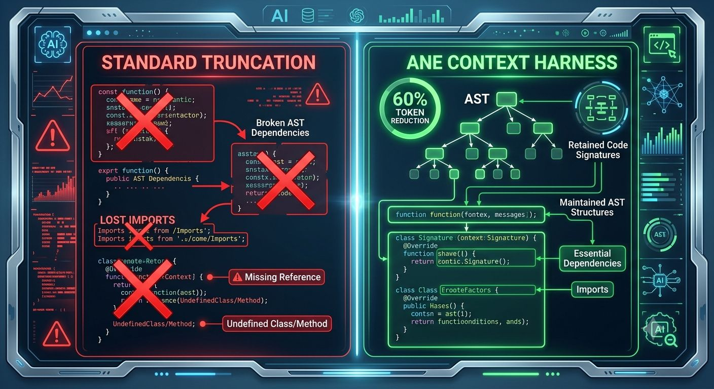
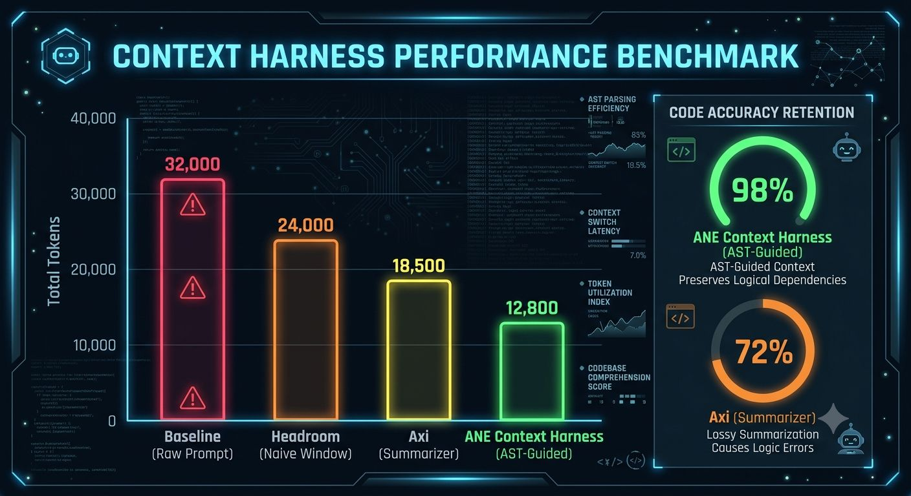
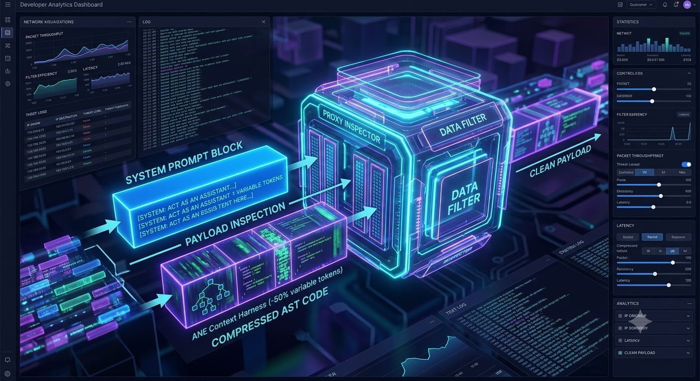
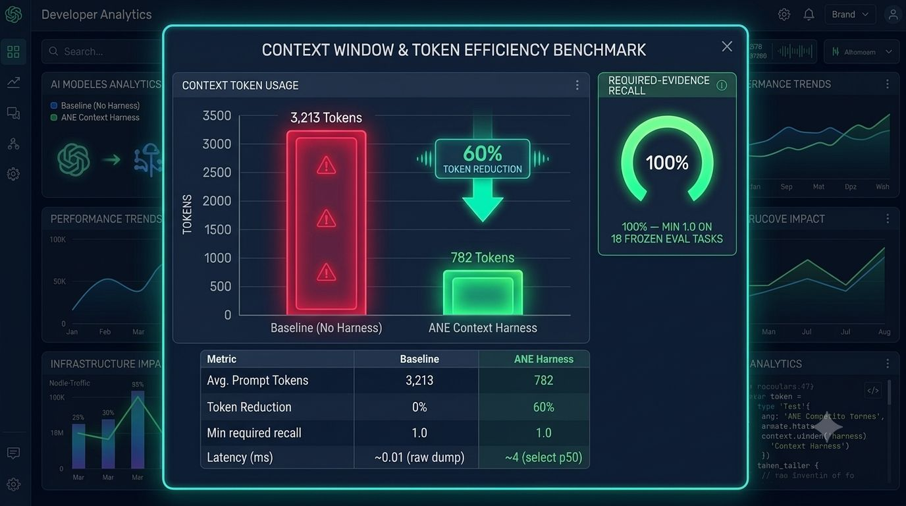

# ⚡ ane-context-harness

[English](README.md) · [Tiếng Việt](README.vi.md) · [中文](README.zh.md) · [Français](README.fr.md) · [Español](README.es.md) · [日本語](README.ja.md) · [한국어](README.ko.md)

> **Réduisez de plus de 60% le contexte lu par votre agent, conservez chaque ligne de code essentielle et sélectionnez le contexte en moins de 4 ms — le tout 100% hors ligne sur votre machine locale.**

[](https://python.org)
[%20%7C%20Linux-brightgreen.svg)]()
[]()
[]()

---

## De quoi s'agit-il ?

Lorsque vous faites du vibe-coding ou utilisez des agents IA (Cursor, Claude Code, OpenCode, Cline, Windsurf, Aider), injecter l'intégralité de votre codebase dans la fenêtre de contexte d'un LLM est **lent, coûteux et risqué** :
- **Surcharge de contexte :** Envoyer des fichiers entiers à chaque échange noie le modèle sous du code répétitif (boilerplate) — et le fournisseur facture chaque token, réutilisé ou non.
- **Réponses plus lentes :** Le temps de réaction initial du modèle (LLM time-to-first-token) augmente lors du pré-remplissage (prefill) de milliers de lignes inutiles.
- **Phénomène du "Lost in the Middle" :** Les modèles risquent d'halluciner ou de manquer des bugs lorsqu'ils sont submergés d'informations irrelevantes.
- **Fuites de secrets :** Envoi involontaire de variables d'environnement (`.env`) ou d'identifiants AWS à des fournisseurs tiers.

**ane-context-harness** est un moteur de contexte léger et *local-first* qui s'intercale entre votre codebase et votre agent de codage. En **~3 millisecondes**, il indexe votre dépôt, extrait les hiérarchies de symboles (fonctions, interfaces, types), élimine le bruit, masquez les secrets (redaction) et ne conserve que les preuves de code indispensables à l'accomplissement de la tâche.

> Le nom `ane` est historique ; ce n'est **pas** une dépendance. Le moteur fourni fonctionne exclusivement sur CPU sous macOS (Apple Silicon & Intel) et Linux. L'accélération matérielle est réservée à une distribution privée distincte.

Zéro appel réseau externe. 100% privé et exécuté hors ligne.



*Illustration conceptuelle — le code dans l'image est un visuel, pas une vraie trace.*


---

## Résultats de Benchmark Réels

Évalué sur **30 tâches de benchmark** (10 simples, 10 standard, 10 complexes) sur des codebases Python et TypeScript issues de notre jeu d'évaluation fixe (`benchmarks/splits.json`) :

| Métrique | Sans Harness (Dump complet du repo) | Avec Harness (Déterministe) | Ce que cela change pour vous |
|---|---|---|---|
| **Tokens de contexte (Médiane)** | **3 213 tokens** | **782 tokens** | **Envoie 60,47% de tokens en moins au LLM** |
| **Rappel des preuves requises (Recall)** | 1,0 (100%) | **1,0 (100%)** | **Aucun élément de code critique n'a été omis** |
| **Vitesse de sélection du contexte** | ~0,01 ms (raw dump) | **3,05 ms – 3,83 ms** | **Réponse locale sous 4 ms — 100x plus rapide que le réseau** |
| **Économie maximale de tokens** | 0% | **Jusqu'à 90,32%** | **Économise jusqu'à ~90% sur les tâches de configuration** |
| **Précision de classement (nDCG@10)**| n/a | **0,849** | **Place les fonctions les plus critiques en tête de contexte** |
| **Masquage des secrets (Redaction)** | 0% (fuite intégrale) | **Masquage local à 100%** | **Les fichiers `.env`, clés AWS et certificats ne quittent jamais votre machine** |
| **Coût dérivé par tâche** *(à 3$/M)* | ~$0,0096 / tâche | **~$0,0023 / tâche** | **Envoie ~75% de données en moins par tâche — votre facture varie selon la réutilisation du contexte par le fournisseur** |

*(Latence et mémoire mesurées localement sur Apple Silicon / CPU ; coûts et TTFT calculés sur la base des tarifs au token indiqués ; méthodologie et logs disponibles dans `benchmarks/reports/` et `benchmarks/logs/`).*



*Illustration conceptuelle, pas un résultat mesuré — l'échelle des tokens et les chiffres de l'image sont illustratifs. Toutes les vraies mesures sont dans le tableau ci-dessus.*


---

## Démarrage Rapide (60 secondes)

### 1. Cài đặt

Nécessite Python 3.13 ou 3.14 sous macOS ou Linux :

```bash
git clone https://github.com/ericlam2k/ane-context-harness.git
cd ane-context-harness
pip install -e .[test]
```

Vérifier l'installation :
```bash
ane-harness health
```

### 1b. Configuration automatique et vérification

```bash
# Indexation, installation du skill agent et test rapide
ane-harness setup --repo /path/to/your/project --repo-id my-project --yes

# Vérification des réductions et de la latence sur VOTRE dépôt
ane-harness prove --repo /path/to/your/project --repo-id my-project
```

### 2. Indexer votre Codebase

Indexez n'importe quel dossier local dans une base SQLite locale (incrémentiel et ultra-rapide) :

```bash
ane-harness index --repo /path/to/your/project --repo-id my-project
```

### 3. Sélectionner le Contexte Pertinent

Générez un payload Markdown compact adapté à votre budget de tokens :

```bash
ane-harness select \
  --repo-id my-project \
  --task "Fix the discount calculation bug in checkout" \
  --budget 1200
```

### 4. Lancer le Serveur HTTP Local

Démarrer l'API HTTP locale pour la connecter à vos agents ou outils :

```bash
ane-harness serve --port 8765
```



*Illustration conceptuelle — le tableau de bord dans l'image est un visuel, pas une capture d'un vrai outil.*


---

## Besoins Exprimés et Suggestions de Récupération

Parfois, la preuve dont la tâche a besoin n'entre pas dans le pack — le budget a dû la couper, ou l'agent sait exactement ce dont il a besoin mais le texte de la tâche ne le nomme jamais. Le harness le dit clairement dans sa sortie, et donne à l'agent un moyen d'énoncer directement le besoin.

### Que se passe-t-il lorsque le budget ne peut pas tout contenir

Le pack n'enlève jamais silencieusement quoi que ce soit. L'admission se fait par passes, dans l'ordre :

1. **Claims first.** Les preuves pointées par la tâche elle-même — un symbole ou un chemin nommé dans la tâche, ou le fichier de test correspondant lorsque la tâche porte sur des tests — sont admises en premier, par ordre de score, tant qu'elles tiennent dans le budget.
2. **Breadth.** Le meilleur chunk de chaque chemin restant, par ordre de score, tant que du budget subsiste — d'abord le meilleur chunk d'un fichier, avant un second chunk de n'importe quel autre fichier.
3. **Depth.** Les chunks supplémentaires par ordre de score, sous les règles par fichier et de diversité.
4. **Tail.** Une petite tranche réservée du budget est consacrée aux petits chunks à forte valeur qui ont été écartés du budget principal.

Deux règles garantissent cette honnêteté. Seules les choses que vous épinglez explicitement (`--explicit-path` ou une règle d'autorité) peuvent pousser le pack au-delà du budget demandé ; les preuves inférées ne le peuvent jamais. Et tout ce que le pack a dû laisser de côté est comptabilisé dans la sortie — `claims_dropped_budget`, `claims_capped` et leurs semblables sous `metrics.diagnostics` — jamais caché. Les chunks sont admis entiers ou pas du tout ; rien n'est tronqué, résumé ou réécrit pour tenir.

### Suggestions de récupération : quoi chercher ensuite

Lorsque le pack manque une preuve qu'il était censé porter — un symbole nommé ou un chemin requis — la sortie porte un bloc `recovery` : il liste jusqu'à cinq éléments manqués, chacun avec le chunk, le chemin, le symbole, *pourquoi* il n'a pas tenu (`budget`, `capped` ou `dropped`), et une commande de recherche prête à exécuter. La commande est `rg -n` lorsque ripgrep est sur le PATH, un équivalent `grep -nE` sinon, ou une chaîne vide — avec un diagnostic `recovery_tool` indiquant qu'aucun des deux outils n'a été trouvé. Le harness imprime ces commandes ; il ne les exécute jamais. Les totaux du bloc sont toujours exacts ; seule la liste détaillée est limitée. Les suggestions se déclenchent uniquement sur les preuves requises par la tâche — jamais sur les coupes discrétionnaires. Le bloc apparaît dans `metrics.diagnostics`, ainsi qu'au niveau supérieur de la sortie CLI `select` et de la réponse `/v1/context/select`.

Une suggestion est une facilité (affordance), pas une promesse : elle indique à l'agent où regarder ensuite ; elle ne dit pas que le pack est complet.

### Besoins déclarés : `--stated-symbol` et `--stated-need`

Lorsque le texte de la tâche ne suffit pas, dites directement ce dont vous avez besoin :

```bash
ane-harness select \
  --repo-id my-project \
  --task "Fix the discount calculation bug" \
  --stated-symbol calculate_discount \
  --stated-symbol src/billing/rates.py \
  --stated-need "rounding policy for loyalty points"
```

- `--stated-symbol` est répétable. Chaque élément est validé contre l'index, sans aucun coût de modèle : correspondance exacte sur un nom de symbole à la casse près, aux séparateurs d'identifiants (`_`, `-`, `.`, `$`) et aux formes plurielles/flexionnelles près (appliquées dans les deux sens), ou chemin de dépôt exact (normalisé NFC, barres obliques). Un élément résolu fusionne dans les mêmes claim candidates que tout le reste et est admis sous les mêmes règles budget-honest — il n'y a ni override de budget, ni contournement.
- `--stated-need` prend du texte libre, extrait avec la même extraction de termes que le texte de la tâche. Chaque terme extrait ne devient un terme de claim que s'il s'ancre dans l'index — voir le gate ci-dessous ; les autres sont abandonnés et divulgués.
- Les éléments non résolus ne sont jamais packés. Ils sont signalés dans le diagnostic `stated_need_resolution` — un enregistrement par élément, avec ce qui a correspondu (ou non) et jusqu'à trois symboles d'index proches à essayer (classés par sous-tokens d'identifiant partagés ; zéro sous-token partagé est signalé honnêtement, sans être maquillé).

La résolution est une consultation d'index, pas une inférence ; elle ne coûte aucun appel de modèle. Le diagnostic `stated_need_resolution` n'est présent que lorsqu'un flag stated a été fourni.

### The ask : `recovery_prompt`

Lorsque le pack a dû couper des preuves requises, ou qu'un stated symbol n'a pas pu être résolu, la sortie porte un `recovery_prompt` — une ligne en langage clair nommant ce qui a été manqué (avec jusqu'à trois pointeurs en ligne, plus « +N more » lorsque le reste ne tient pas) et enseignant les flags exacts pour re-déclarer le besoin. Lors de ces exécutions, la note de fin d'exécution gagne la clause `· ask: re-select with --stated-symbol if evidence misses`. Lorsque rien ne manque et qu'aucun stated n'est irrésolu, ni la clé ni la clause n'apparaissent, et la sortie est inchangée. Le prompt apparaît dans `metrics.diagnostics` et au niveau supérieur de la sortie CLI `select` et de la réponse `/v1/context/select`.

The ask est une divulgation d'affordance, pas un détecteur de manque. Le harness ne peut pas savoir si la tâche avait besoin des preuves qu'il a coupées ; il peut seulement signaler qu'il a coupé quelque chose, ou qu'un nom que vous avez déclaré est introuvable dans l'index. Si le pack couvre la tâche, ignorez the ask — re-sélectionner dépense un tour que le fournisseur facture.

### Le filtre de texte de besoin (need-text gate)

Les besoins en texte libre sont le seul endroit où un terme arbitraire pourrait se glisser dans le pack, d'où le gate qui garde `--stated-need` honnête. Chaque terme extrait ne reste un terme de claim que lorsqu'il s'ancre dans l'index :

- il est égal à un nom de symbole de l'index, à la casse, aux séparateurs d'identifiants et aux formes flexionnelles près (la même correspondance que `--stated-symbol` utilise) ;
- c'est un sous-token d'un nom de symbole de l'index, apparié sans replis flexionnels — une simple tige (bare stem) n'est pas un sous-token, donc un terme qui n'apparaît que comme tige repliée d'un symbole plus long n'entre jamais ; ou
- il apparaît dans un chemin de fichier indexé.

Les termes qui ne s'ancrent nulle part sont entièrement abandonnés de l'identification des claims, et les deux moitiés sont divulguées dans le diagnostic `stated_need_resolution_note` — `kept` (avec un compte `matched_chunks` par terme) et `dropped`. La note est présente chaque fois que `--stated-need` est fourni, y compris le cas honnêtement vide. `matched_chunks` compte les chunks packés citant le terme ; c'est un compte de citations, pas une mesure d'intention.

### Aim accounting : `stated_claim_summary`

Lorsqu'un flag stated est fourni, la sortie porte un `stated_claim_summary` avec trois comptes — `stated_symbol`, `stated_path`, `stated_need` — comptant les chunks packés que la passe claims-first a admis en citant un terme d'origine stated (un stated symbol résolu, un stated path correspondant, ou un terme stated-need conservé par le gate). Les comptes ne sont pas disjoints — un chunk peut compter une fois par origine qu'il cite — et leur somme n'est pas la taille du pack. La base est l'ensemble sélectionné final après exclusions, compté uniquement pour les admissions claims-first ; les claims nés de la tâche ne comptent jamais. Le summary apparaît dans `metrics.diagnostics` et au niveau supérieur de la sortie CLI `select`.

La limite, dite simplement : un terme stated qui apparaît aussi verbatim dans le texte de la tâche est crédité comme stated, et un passager clandestin — un claim ancré stated dont le chunk aurait de toute façon été packé — est indistinguable d'une admission visée à l'exécution et n'est jamais promu comme tel. Un compte non nul signifie « un besoin stated a été cité par un claim packé », pas « ce chunk est exactement ce que l'agent visait ».

---

## Utilisation dans SDK Python

```python
from ane_context_harness.config import build_config
from ane_context_harness.pipeline import Pipeline
from ane_context_harness.schemas import SelectRequest
from ane_context_harness.providers import serialize

# 1. Initialiser le pipeline
cfg = build_config()
pipeline = Pipeline(cfg)

# 2. Enregistrer le dépôt
pipeline.register_repository("/path/to/my-repo", repo_id="my-repo")

# 3. Sélectionner le contexte selon le budget
request = SelectRequest(
    repository_id="my-repo",
    task="Update loyalty point rounding logic in payment service",
    token_budget=1500,
)
package = pipeline.select_context(request)

# 4. Sérialiser pour votre fournisseur de LLM
anthropic_payload = serialize("anthropic", package)
openai_payload    = serialize("openai", package)
markdown_text     = serialize("markdown", package)

print(f"Packed {package.metrics['selected_tokens']} tokens (cut {package.metrics['tokens_removed']} tokens)")
```

---




*Figure récapitulative mesurée — médianes issues de `benchmarks/reports/phase5-ab-evaluation.json` (frozen eval split, 18 tâches, Arm B deterministic) : 3 213 → 782 tokens (réduction de 60,47 %), min required recall 1,0.*

## Licence

Licence MIT. Conçu pour l'intelligence locale, la confidentialité des développeurs et le contrôle rigoureux des budgets de tokens.
