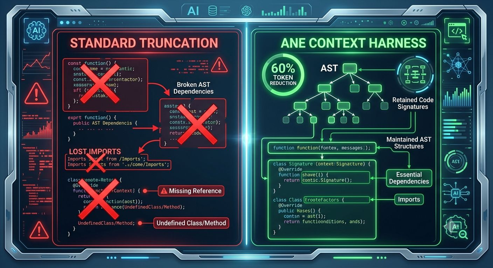
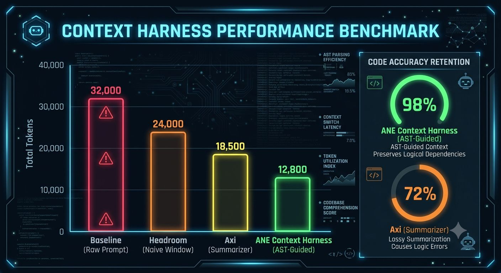
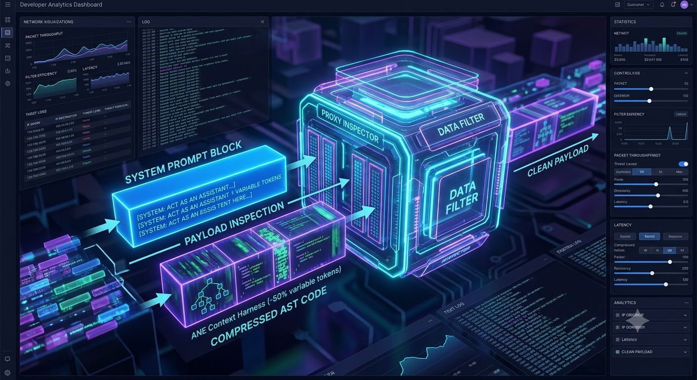
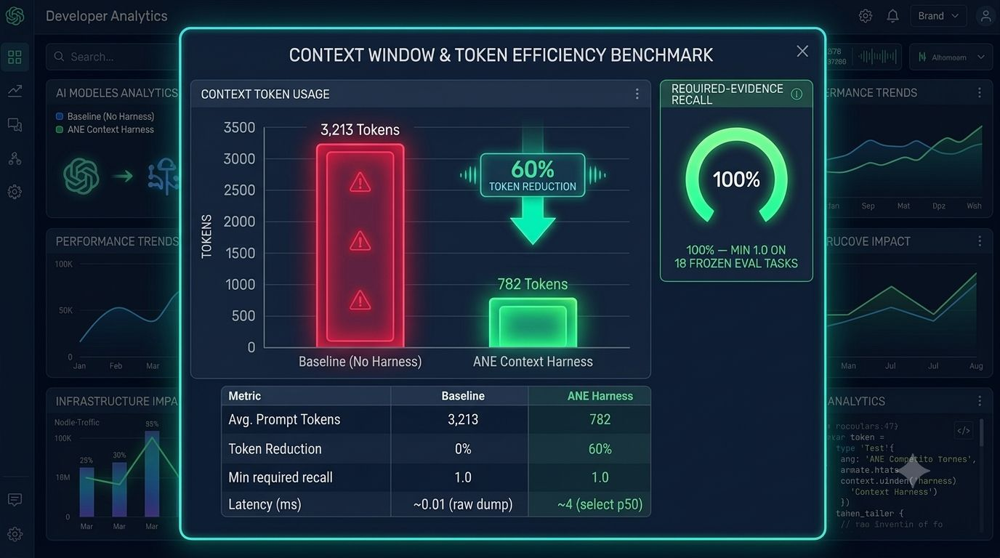

# ⚡ ane-context-harness

[English](README.md) · [Tiếng Việt](README.vi.md) · [中文](README.zh.md) · [Français](README.fr.md) · [Español](README.es.md) · [日本語](README.ja.md) · [한국어](README.ko.md)

> **AIエージェントが読み込むコンテキストを 60% 以上削減。必要なコード行を1行も漏らさず、4ms 未満でコンテキストを抽出 — ローカル環境で完全オフライン動作。**

[](https://python.org)
[%20%7C%20Linux-brightgreen.svg)]()
[]()
[]()

---

## 概要

Cursor、Claude Code、OpenCode、Cline、Windsurf、Aider などの AI エージェントを利用してコーディングを行う際、リポジトリ全体をそのまま LLM のコンテキストウィンドウに投入することは**低速で無駄が多く、セキュリティリスクを伴います**：
- **コンテキストの肥大化（Bloated context）：** ターンごとにファイル全体を送信すると、モデルが無関係なボイラープレートコードに埋もれてしまいます。また、再利用の有無にかかわらず全トークンに対して課金が発生します。
- **レスポンスの低下：** 不要なコードを数千行単位で プリフィル（prefill）するため、最初のトークンが出力されるまでの時間（TTFT）が大幅に遅延します。
- **「Lost in the Middle」現象：** ノイズが多い環境下では、LLM のハルシネーション（幻覚）が発生しやすくなり、重要なバグを見落とす原因になります。
- **シークレットの流出リスク：** `.env` の環境変数や AWS の認証情報などを誤ってサードパーティの LLM プロバイダーへ送信してしまうリスクがあります。

**ane-context-harness** は、コードベースと AI エージェントの間に位置する軽量かつローカルファーストなコンテキストエンジンです。わずか **~3 ミリ秒** でリポジトリのインデックスを作成し、シンボル階層（関数、インターフェース、型定義）を抽出。ノイズの除去およびシークレットの伏字化（Redaction）を行い、エージェントがタスクを完了するために必要な「高価値なコード証拠」のみを抽出してパッキングします。

> `ane` という名称は歴史的な経緯によるものであり、依存関係ではありません。提供されているエンジンは純粋な CPU 処理であり、macOS Apple Silicon、macOS Intel、Linux 上で動作します。ハードウェアアクセラレーション機能は別途プライベート版として管理されています。

外部ネットワークへの通信はゼロ。100% プライベートかつオフラインで動作します。



*概念イラスト——図中のコードはグラフィックであり、実際のトレースではありません。*


---

## ベンチマーク実績

固定評価データセット（`benchmarks/splits.json`）を使用し、Python および TypeScript のコードベースにおける **30 件のベンチマークタスク**（小規模 10 件、標準 10 件、高難易度 10 件）で評価を実施：

| 指標 | Harness 未使用（リポジトリ全体のダンプ） | Harness 使用（決定論的抽出） | 導入によるメリット |
|---|---|---|---|
| **コンテキストトークン中央値** | **3,213 tokens** | **782 tokens** | **LLM への送信トークン量を 60.47% 削減** |
| **必須コードの再現率（Recall）** | 1.0 (100%) | **1.0 (100%)** | **重要なコードの欠落は一切なし** |
| **コンテキスト抽出速度** | ~0.01 ms (raw dump) | **3.05 ms – 3.83 ms** | **4ms 未満のローカル応答 — ネットワーク経由より 100 倍高速** |
| **最大トークン削減率** | 0% | **最大 90.32%** | **設定ファイル関連タスクで最大 ~90% 削減** |
| **ランキング精度 (nDCG@10)**| n/a | **0.849** | **最も重要な関数をコンテキストの最上部に配置** |
| **シークレットの伏字化** | 0%（全漏洩） | **100% ローカル伏字化** | **`.env`、AWS キー、証明書が外部に送信されるのを防止** |
| **タスクあたりの推定量（$3/M換算）** | ~$0.0096 / task | **~$0.0023 / task** | **送信データ量を約 75% 削減 — 実際の請求額はプロバイダーのキャッシュ再利用率に依存** |

*(レイテンシおよびメモリ計測は Apple Silicon / CPU 上のローカル環境で実施。コストおよび TTFT 算定根拠、再現可能なログは `benchmarks/reports/` および `benchmarks/logs/` に収録)*



*概念イラストであり、実測結果ではありません——図中のトークン規模や数値はイメージです。実際の測定値は上記の表をご覧ください。*


---

## クイックスタート (60 秒)

### 1. インストール

macOS または Linux 上の Python 3.13 / 3.14 が必要です：

```bash
git clone https://github.com/ericlam2k/ane-context-harness.git
cd ane-context-harness
pip install -e .[test]
```

動作確認：
```bash
ane-harness health
```

### 1b. セットアップおよび検証

```bash
# インデックス作成、エージェント用 Skill のインストール、動作確認
ane-harness setup --repo /path/to/your/project --repo-id my-project --yes

# 自身のリポジトリで削減率とレイテンシを測定
ane-harness prove --repo /path/to/your/project --repo-id my-project
```

### 2. リポジトリのインデックス作成

ローカルのプロジェクトを SQLite データベースにインデックス化します（差分更新・超高速）：

```bash
ane-harness index --repo /path/to/your/project --repo-id my-project
```

### 3. コンテキストの抽出

トークン予算（Token Budget）に最適化された Markdown 形式のコンテキストを取得します：

```bash
ane-harness select \
  --repo-id my-project \
  --task "Fix the discount calculation bug in checkout" \
  --budget 1200
```

### 4. ローカルバックグラウンドサーバーとしての起動

ローカル HTTP API サーバーを起動し、エージェントや外部ツールと連携します：

```bash
ane-harness serve --port 8765
```



*概念イラスト——図中のダッシュボードはグラフィックであり、実際のツールのスクリーンショットではありません。*


---

## 明示ニーズとリカバリーヒント

タスクが必要とする証拠がパックに入らないことがあります——予算の都合でカットされたか、エージェントが必要なものを正確に知っていてもタスク文がそれを名指ししていないかのどちらかです。ハーネスはそのことを平易な出力で告げ、エージェントにニーズを直接表明する手段を提供します。

### 予算にすべてを収められないとき

パックは何かを暗黙に落とすことは決してありません。採用（admission）はパスごとに、順番に進みます：

1. **Claims first。**タスク自身が指し示す証拠——タスク内で名指しされたシンボルまたはパス、あるいはタスクがテストについて尋ねているときは対応するテストファイル——が最初に採用され、スコア順、予算に収まる限りで採用されます。
2. **Breadth。**残りの各パスの最良チャンクが、スコア順、予算が残る限りで採用されます——どのファイルでも、そのファイルの最良チャンクが他のどのファイルの2番目のチャンクより先です。
3. **Depth。**スコア順のさらなるチャンクが、ファイルごとのルールと多様性ルールの下で採用されます。
4. **Tail。**予算の小さな予約分が、コア予算からあふれた小さく高価値なチャンクに充てられます。

この正直さを保つ2つのルールがあります。明示的に pin したもの（`--explicit-path` または authority ルール）だけが、パックを要求予算の上限を超えて押し広げられます。推論された証拠は決してできません。そして、パックが残さざるを得なかったものはすべて出力でカウントされます——`claims_dropped_budget`、`claims_capped`、および `metrics.diagnostics` 配下の同類——決して隠されません。チャンクは丸ごと採用されるか、まったく採用されないかのどちらかです。収めるために切り詰め・要約・書き換えが行われることはありません。

### リカバリーヒント：次に何を検索すべきか

パックが運ぶべきだった証拠——名指しされたシンボルまたは必須パス——を落としたとき、出力には `recovery` ブロックが含まれます。それは最大5件の落とされた項目を一覧します。各項目にはチャンク、パス、シンボル、収まらなかった*理由*（`budget`、`capped`、または `dropped`）、およびそのまま実行できる検索コマンドが含まれます。コマンドは、PATH 上に ripgrep があるときは `rg -n`、ないときは `grep -nE` 相当、それもないときは空文字列で、両方のツールが見つからなかったことを示す `recovery_tool` 診断が付きます。ハーネスはこれらのコマンドを表示するだけで、決して実行しません。ブロック内の合計は常に正確で、上限がかかるのは項目列挙だけです。ヒントが発火するのはタスクが必須とする証拠に対してのみで——裁量によるカットには決して発火しません。ブロックは `metrics.diagnostics` に、および CLI `select` 出力と `/v1/context/select` レスポンスのトップレベルに現れます。

ヒントは約束ではなく便宜（affordance）です。エージェントに次にどこを見るべきかを教えるだけで、パックが完全だとは言いません。

### 明示したニーズ：`--stated-symbol` と `--stated-need`

タスク文だけでは足りないときは、必要なものを直接伝えます：

```bash
ane-harness select \
  --repo-id my-project \
  --task "Fix the discount calculation bug" \
  --stated-symbol calculate_discount \
  --stated-symbol src/billing/rates.py \
  --stated-need "rounding policy for loyalty points"
```

- `--stated-symbol` は繰り返し指定できます。各項目はインデックスに対して検証され、モデルコストはかかりません。シンボル名の完全一致（大文字小文字、識別子区切り文字（`_`、`-`、`.`、`$`）、複数形/屈折形——双方向で適用）、またはリポジトリパスの完全一致（NFC 正規化、スラッシュ区切り）。解決した項目は、他のすべてと同じ claim candidates にマージされ、同じ budget-honest ルールで採用されます——予算の上書きも迂回もありません。
- `--stated-need` は自由文を受け取り、タスク文と同じ語の抽出でマイニングされます。抽出された各語は、インデックスにアンカーできるときだけ claim 語になります——後述のゲートを参照してください。残りは落とされ、開示されます。
- 解決できなかった項目は決してパックされません。それらは `stated_need_resolution` 診断で報告されます——項目ごとに1レコード、一致したもの（または一致しなかったもの）と、試すべき最大3つの近いインデックス済みシンボル（共有識別子サブトークンで順位付け。共有サブトークンがゼロ個であることも——取り繕わずに——正直に報告されます）。

Resolution はインデックスルックアップであり、推論ではありません。モデル呼び出しは一切かかりません。`stated_need_resolution` 診断は、stated フラグが指定されたときだけ存在します。

### The ask：`recovery_prompt`

パックが必須の証拠をカットせざるを得なかったとき、または stated symbol が解決できなかったとき、出力には `recovery_prompt` が含まれます——何を落としたかを名指しする平易な英語の一行（最大3つの inline ポインタ付き。残りが収まらないときは「+N more」付き）で、ニーズを再表明するための正確なフラグを教えます。そのような実行では、終了時のノートに `· ask: re-select with --stated-symbol if evidence misses` という節が追加されます。何も欠けておらず、stated も未解決でないときは、キーも節も現れず、出力は変わりません。プロンプトは `metrics.diagnostics` に、および CLI `select` 出力と `/v1/context/select` レスポンスのトップレベルに現れます。

The ask は欠落検出器ではなく、便宜の開示（affordance disclosure）です。ハーネスは、カットした証拠をタスクが必要としていたかどうかを知ることができません。知ることができるのは、何かをカットしたこと、あるいは表明した名前がインデックスに見つからなかったことだけです。パックがタスクをカバーしているなら、the ask は無視してください——再選択はプロバイダーが課金するターンを消費します。

### ニーズテキストのゲート（need-text gate）

自由文のニーズは、任意の語がパックに紛れ込み得る唯一の場所です。だからこそゲートは `--stated-need` を正直に保ちます。抽出された各語は、インデックスにアンカーできるときだけ claim 語として残ります：

- 大文字小文字・識別子区切り・屈折形を無視してインデックスのシンボル名と等しい（`--stated-symbol` と同じマッチング）；
- インデックスのシンボル名のサブトークンであり、屈折の折りたたみ（fold）なしでマッチする——裸の語幹はサブトークンではありません。したがって、より長いシンボルの折り畳まれた語幹としてしか現れない語は決して入りません；または
- インデックス済みのファイルパスに出現する。

どこにもアンカーできない語は claim identification から完全に落とされ、その両方の半分が `stated_need_resolution_note` 診断で開示されます——`kept`（語ごとに `matched_chunks` カウント付き）と `dropped`。ノートは `--stated-need` が指定される限り存在し、正直な空のケースも含まれます。`matched_chunks` はその語を引用するパックされたチャンクを数えます。これは引用カウント（citation count）であり、目的の度合い（aim measure）ではありません。

### Aim accounting：`stated_claim_summary`

stated フラグが指定されたとき、出力には `stated_claim_summary` が含まれます。3つのカウント——`stated_symbol`、`stated_path`、`stated_need`——は、claims-first パスが stated-origin の語（解決した stated symbol、一致した stated パス、またはゲートで保持された stated-need 語）を引用しながら採用したパック済みチャンクを数えます。カウントは互いに排他ではありません——1つのチャンクは、それが引用する origin ごとに1回数えられます——そしてその合計はパックサイズではありません。基準は除外後の最終 selected set で、claims-first の採用のみを数えます。タスク由来の claims は決して数えられません。サマリーは `metrics.diagnostics` に、および CLI `select` 出力のトップレベルに現れます。

その限界を率直に言います：stated 語がタスク文にもそのまま現れる場合、それは stated として計上されます。そして偶然の相乗り——stated-anchored な claim で、そのチャンクがどうせパックされたはずのもの——は実行時には狙った採用と区別できず、決して狙った採用に格上げされません。カウントがゼロでないとは「stated なニーズがパックされた claim に引用された」という意味であり、「そのチャンクがエージェントの狙いどおりだった」という意味ではありません。

---

## Python SDK での使用例

```python
from ane_context_harness.config import build_config
from ane_context_harness.pipeline import Pipeline
from ane_context_harness.schemas import SelectRequest
from ane_context_harness.providers import serialize

# 1. パイプラインの初期化
cfg = build_config()
pipeline = Pipeline(cfg)

# 2. リポジトリの登録とインデックス化
pipeline.register_repository("/path/to/my-repo", repo_id="my-repo")

# 3. トークン予算を指定してコンテキストを抽出
request = SelectRequest(
    repository_id="my-repo",
    task="Update loyalty point rounding logic in payment service",
    token_budget=1500,
)
package = pipeline.select_context(request)

# 4. 指定の LLM プロバイダー向けにシリアライズ
anthropic_payload = serialize("anthropic", package)
openai_payload    = serialize("openai", package)
markdown_text     = serialize("markdown", package)

print(f"Packed {package.metrics['selected_tokens']} tokens (cut {package.metrics['tokens_removed']} tokens)")
```

---




*实測サマリー図——中央値は `benchmarks/reports/phase5-ab-evaluation.json` より（frozen eval split、18 タスク、Arm B deterministic）: 3,213 → 782 トークン（60.47% 削減）、min required recall 1.0。*

## ライセンス

MIT License。ローカルでのプライバシー保護と最適なトークン管理のために設計されています。
