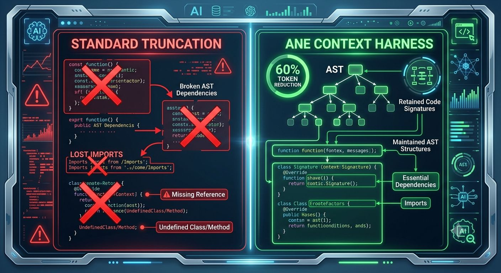
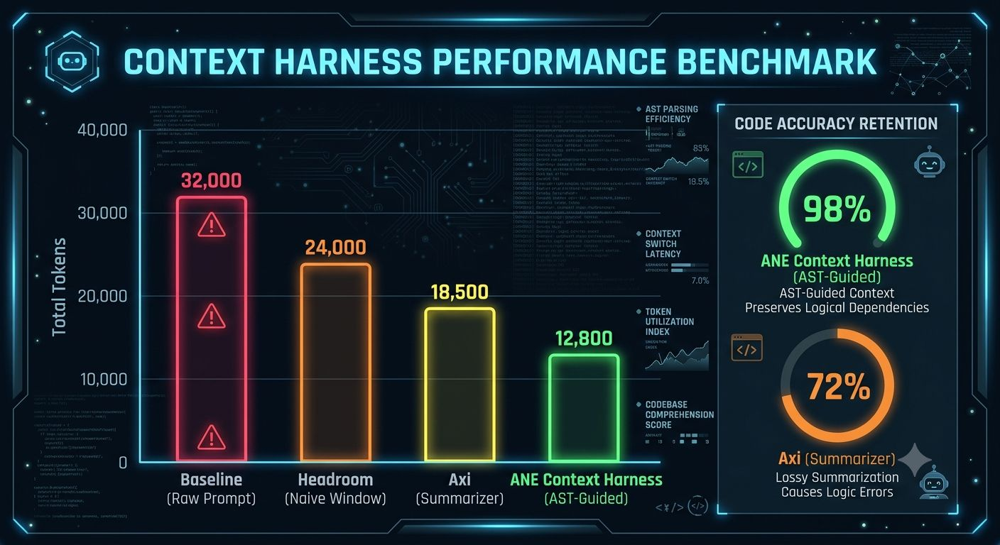
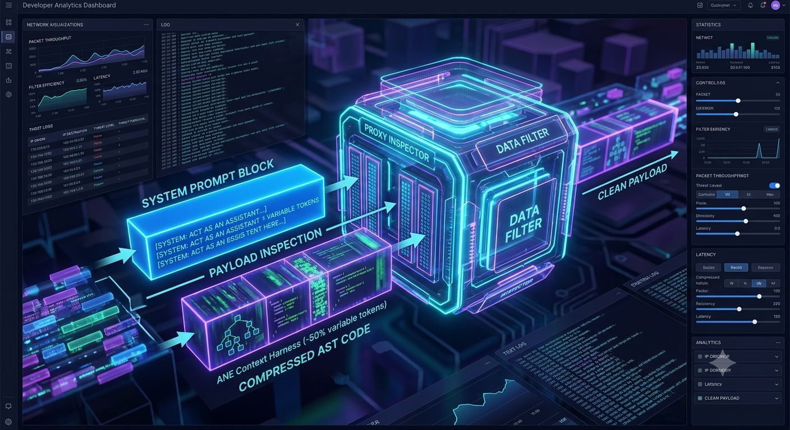
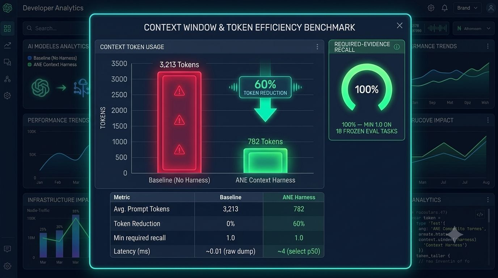

# ⚡ ane-context-harness

[English](README.md) · [Tiếng Việt](README.vi.md) · [中文](README.zh.md) · [Français](README.fr.md) · [Español](README.es.md) · [日本語](README.ja.md) · [한국어](README.ko.md)

> **AI 에이전트가 읽는 컨텍스트를 60% 이상 절감하고, 필요한 필수 코드는 100% 유지하며, 4ms 이내에 컨텍스트를 추출합니다 — 로컬 머신에서 완전한 오프라인으로 작동.**

[](https://python.org)
[%20%7C%20Linux-brightgreen.svg)]()
[]()
[]()

---

## 어떤 도구인가요?

Cursor, Claude Code, OpenCode, Cline, Windsurf, Aider와 같은 AI 에이전트를 활용해 바이브 코딩(vibe-coding)을 진행할 때, 전체 코드베이스를 LLM 컨텍스트 윈도우에 그대로 전달하는 것은 **느리고, 비효율적이며, 보안상 위험**합니다:
- **컨텍스트 비대화 (Bloated Context):** 매 턴(turn)마다 전체 파일을 주입하면 모델이 불필요한 보일러플레이트 코드에 파묻히게 되며, 공급업체는 재사용 여부와 상관없이 모든 토큰에 비용을 청구합니다.
- **응답 속도 지연:** 불필요한 수천 줄의 코드를 프리필(prefill)하느라 첫 번째 토큰 생성 시간(TTFT)이 크게 지연됩니다.
- **"Lost in the Middle" 현상:** 모델이 불필요한 정보에 묻히면 할루시네이션(환각)을 일으키거나 중요한 버그를 놓치기 쉽습니다.
- **시크릿 유출 위험:** `.env` 환경 변수나 AWS 자격 증명 등이 의도치 않게 외부 LLM 공급업체로 전송될 수 있습니다.

**ane-context-harness**는 코드베이스와 코딩 에이전트 사이에서 동작하는 경량 로컬 퍼스트(Local-First) 컨텍스트 엔진입니다. 단 **~3밀리초** 만에 리포지토리를 인덱싱하고, 심볼 계층 구조(함수, 인터페이스, 타입)를 추출하며, 노이즈를 제거하고, 시크릿을 마스킹(Redaction)하여 에이전트가 작업에 실제 필요한 고가치 코드 증거만을 패킹합니다.

> `ane`라는 이름은 과거 프로젝트의 유산이며 필수 종속성이 아닙니다. 배포 버전은 순수 CPU 기반으로 작동하며 macOS Apple Silicon, macOS Intel 및 Linux를 완벽히 지원합니다. 하드웨어 가속 기능은 별도의 프라이빗 배포판으로 관리됩니다.

외부 네트워크 호출 0건. 100% 개인정보 보호 및 오프라인 동작.



*개념 일러스트 — 그림 속 코드는 그래픽이며 실제 트레이스가 아닙니다.*


---

## 실제 벤치마크 결과

고정된 평가 분할 데이터셋(`benchmarks/splits.json`) 기준 Python 및 TypeScript 코드베이스의 **30개 벤치마크 태스크**(소형 10개, 일반 10개, 고난도 10개) 평가 결과:

| 지표 | Harness 미사용 (전체 덤프) | Harness 사용 (결정론적 추출) | 실제 사용자 이점 |
|---|---|---|---|
| **중앙값 컨텍스트 토큰** | **3,213 tokens** | **782 tokens** | **LLM 전송 토큰량 60.47% 절감** |
| **필수 코드 재현율 (Recall)** | 1.0 (100%) | **1.0 (100%)** | **핵심 코드 단 한 줄도 누락 없음** |
| **컨텍스트 추출 속도** | ~0.01 ms (raw dump) | **3.05 ms – 3.83 ms** | **4ms 미만 로컬 응답 — 네트워크 대비 100배 빠른 속도** |
| **최대 토큰 절감율** | 0% | **최대 90.32%** | **설정 파일 관련 작업에서 최대 ~90% 절감** |
| **랭킹 정확도 (nDCG@10)**| n/a | **0.849** | **가장 중요한 함수를 컨텍스트 최상단에 배치** |
| **시크릿 마스킹 (Redaction)** | 0% (전체 유출) | **100% 로컬 마스킹** | **`.env`, AWS 키, 인증서가 로컬 머신을 벗어나지 않음** |
| **태스크당 추정 비용** *($3/M 토큰 기준)* | ~$0.0096 / task | **~$0.0023 / task** | **기본 요율 기준 전송량 ~75% 절감 — 실제 청구액은 공급업체의 프롬프트 캐시 재사용률에 따라 결정됨** |

*(레이턴시 및 메모리는 Apple Silicon / CPU 로컬 환경에서 측정; 비용 및 TTFT 수치는 표준 토큰 요율 기준 추정치; 상세 방법론 및 로그는 `benchmarks/reports/` 및 `benchmarks/logs/` 참조)*



*개념 일러스트이며 측정 결과가 아닙니다 — 그림 속 토큰 규모와 수치는 예시입니다. 실제 측정값은 위의 표를 참조하십시오.*


---

## 빠른 시작 (60초)

### 1. 설치

macOS 또는 Linux 환경의 Python 3.13 또는 3.14가 필요합니다:

```bash
git clone https://github.com/ericlam2k/ane-context-harness.git
cd ane-context-harness
pip install -e .[test]
```

설치 확인:
```bash
ane-harness health
```

### 1b. 원클릭 설정 및 검증

```bash
# 인덱싱, 에이전트 스킬 설치 및 스모크 테스트 수행
ane-harness setup --repo /path/to/your/project --repo-id my-project --yes

# 사용자의 리포지토리에서 토큰 절감률 및 레이턴시 검증
ane-harness prove --repo /path/to/your/project --repo-id my-project
```

### 2. 리포지토리 인덱싱

로컬 프로젝트를 로컬 SQLite 데이터베이스에 인덱싱합니다 (증분 업데이트 지원, 초고속):

```bash
ane-harness index --repo /path/to/your/project --repo-id my-project
```

### 3. 최적화된 컨텍스트 추출

지정된 토큰 예산(Token Budget)에 최적화된 Markdown 형식의 컨텍스트 패키지를 가져옵니다:

```bash
ane-harness select \
  --repo-id my-project \
  --task "Fix the discount calculation bug in checkout" \
  --budget 1200
```

### 4. 로컬 백그라운드 서버로 실행

에이전트나 외부 도구와 연동할 수 있는 로컬 HTTP API 서버를 실행합니다:

```bash
ane-harness serve --port 8765
```



*개념 일러스트 — 그림 속 대시보드는 그래픽이며 실제 도구의 스크린샷이 아닙니다.*


---

## 명시한 니즈와 복구 힌트

태스크가 필요로 하는 증거가 팩에 들어가지 못하는 경우가 있습니다 — 예산이 잘라낼 수밖에 없었거나, 에이전트가 정확히 필요한 것을 알고 있지만 태스크 문구가 그것을 지목하지 않은 경우입니다. 하네스는 그 사실을 출력에 평이하게 명시하고, 에이전트가 니즈를 직접 명시할 수 있는 방법을 제공합니다.

### 예산에 모든 것을 담을 수 없을 때

팩은 아무것도 조용히 버리지 않습니다. 수용(admission)은 패스(pass) 단위로, 순서대로 진행됩니다:

1. **Claims first.** 태스크 자신이 가리키는 증거 — 태스크에 이름이 언급된 심볼이나 경로, 또는 태스크가 테스트를 묻는 경우 해당 테스트 파일 — 가 먼저, 점수 순으로, 예산에 들어가는 한 수용됩니다.
2. **Breadth.** 남은 각 경로의 최고 청크가, 점수 순으로, 예산이 남는 한 수용됩니다 — 어느 파일의 최고 청크든, 다른 어떤 파일의 두 번째 청크보다 먼저입니다.
3. **Depth.** 점수 순의 추가 청크가, 파일별 및 다양성 규칙 아래에서 수용됩니다.
4. **Tail.** 예산의 작은 예약분이, 코어 예산에서 밀려난 작고 가치 높은 청크에 쓰입니다.

두 가지 규칙이 이 정직함을 지킵니다. 명시적으로 pin한 것(`--explicit-path` 또는 authority 규칙)만이 팩을 요청한 예산 너머로 밀어낼 수 있습니다. 추론된 증거는 결코 그럴 수 없습니다. 그리고 팩이 남겨둘 수밖에 없었던 모든 것은 출력에 계수됩니다 — `claims_dropped_budget`, `claims_capped` 및 `metrics.diagnostics` 아래의 유사 항목들 — 결코 숨기지 않습니다. 청크는 온전히 수용되거나 아예 수용되지 않습니다. 맞추기 위해 잘라내거나, 요약하거나, 다시 쓰지 않습니다.

### 복구 힌트: 다음에 무엇을 검색할까

팩이 운반해야 했던 증거 — 이름이 언급된 심볼이나 필수 경로 — 를 놓치면, 출력에는 `recovery` 블록이 담깁니다. 최대 다섯 개의 놓친 항목이 나열되며, 각 항목에는 청크, 경로, 심볼, 들어가지 못한 *이유*(`budget`, `capped`, `dropped`), 그리고 바로 실행할 수 있는 검색 명령이 포함됩니다. 명령은 PATH에 ripgrep이 있으면 `rg -n`, 없으면 동등한 `grep -nE`, 둘 다 없으면 빈 문자열이며, 두 도구 모두 발견되지 않았다는 `recovery_tool` 진단이 함께 나옵니다. 하네스는 이 명령들을 인쇄만 할 뿐, 절대 실행하지 않습니다. 블록의 합계는 항상 정확하며, 항목별 나열만 상한이 적용됩니다. 힌트는 태스크가 요구하는 증거에서만 발동합니다 — 재량적 삭감에는 결코 발동하지 않습니다. 블록은 `metrics.diagnostics`에, 그리고 CLI `select` 출력과 `/v1/context/select` 응답의 최상위 수준에 나타납니다.

힌트는 약속이 아니라 편의(affordance)입니다: 에이전트에게 다음에 어디를 봐야 하는지 알려줄 뿐, 팩이 완전하다고 말하지는 않습니다.

### 명시한 니즈: `--stated-symbol` 및 `--stated-need`

태스크 문구만으로는 부족할 때, 필요한 것을 직접 말하십시오:

```bash
ane-harness select \
  --repo-id my-project \
  --task "Fix the discount calculation bug" \
  --stated-symbol calculate_discount \
  --stated-symbol src/billing/rates.py \
  --stated-need "rounding policy for loyalty points"
```

- `--stated-symbol`은 반복 지정할 수 있습니다. 각 항목은 인덱스에 대해 검증되며 모델 비용이 들지 않습니다. 심볼 이름의 정확한 일치(대소문자, 식별자 구분자(`_`, `-`, `.`, `$`), 복수형/굴절 형태를 양방향으로 적용), 또는 정확한 저장소 경로(NFC 정규화, 슬래시 구분). 해결된 항목은 다른 모든 후보와 같은 claim candidates에 병합되어 동일한 budget-honest 규칙으로 수용됩니다 — 예산 재정의도, 우회도 없습니다.
- `--stated-need`은 자유 텍스트를 받으며, 태스크 문구와 동일한 용어 추출로 마이닝됩니다. 추출된 각 용어는 인덱스에 앵커될 때만 claim 용어가 됩니다 — 아래의 게이트를 참조하십시오. 나머지는 버려지고 그 사실이 공개됩니다.
- 해결되지 않은 항목은 절대 팩에 담기지 않습니다. 이들은 `stated_need_resolution` 진단에 보고됩니다 — 항목당 하나의 레코드, 매치된 것(또는 매치되지 않은 것)과 시도해볼 수 있는 최대 세 개의 가까운 인덱싱된 심볼(공유 식별자 서브토큰 기준 순위, 공유 서브토큰이 0개라는 사실도 포장하지 않고 솔직하게 보고됨).

Resolution은 추론이 아니라 인덱스 조회입니다. 모델 호출 비용이 전혀 들지 않습니다. `stated_need_resolution` 진단은 stated 플래그가 주어졌을 때만 나타납니다.

### The ask: `recovery_prompt`

팩이 필수 증거를 잘라낼 수밖에 없었거나, stated symbol을 해결할 수 없었을 때, 출력에는 `recovery_prompt`가 담깁니다 — 놓친 것을 명시하는 평이한 문장 한 줄(최대 세 개의 인라인 포인터, 나머지가 들어가지 않으면 "+N more" 추가)이며, 니즈를 다시 명시하는 정확한 플래그를 알려줍니다. 그런 실행에서는 종료 메모에 `· ask: re-select with --stated-symbol if evidence misses` 절이 추가됩니다. 빠진 것이 없고 stated가 미해결인 것도 없으면, 키도 절도 나타나지 않으며 출력은 변하지 않습니다. 프롬프트는 `metrics.diagnostics`에, 그리고 CLI `select` 출력과 `/v1/context/select` 응답의 최상위 수준에 나타납니다.

The ask는 누락 탐지기가 아니라 편의(affordance) 고지입니다. 하네스는 잘라낸 증거를 태스크가 필요로 했는지 알 수 없습니다 — 무언가를 잘라냈다는 사실, 혹은 명시한 이름이 인덱스에서 발견되지 않았다는 사실만 보고할 수 있습니다. 팩이 태스크를 커버한다면 the ask를 무시하십시오 — 다시 선택하는 것은 공급업체가 청구하는 턴 하나를 추가로 쓰는 것입니다.

### 니즈 텍스트 게이트 (need-text gate)

자유 텍스트 니즈는 임의의 용어가 팩에 슬쩍 들어올 수 있는 유일한 자리이며, 그래서 게이트가 `--stated-need`를 정직하게 유지합니다. 추출된 각 용어는 인덱스에 앵커될 때만 claim 용어로 남습니다:

- 대소문자·식별자 구분자·굴절 형태를 무시하고 인덱스의 심볼 이름과 일치 (`--stated-symbol`이 사용하는 것과 같은 매칭);
- 인덱스의 심볼 이름의 서브토큰이며, 굴절 폴드 없이 매칭됨 — 벗겨진 어간(bare stem)은 서브토큰이 아니므로, 더 긴 심볼의 폴딩된 어간으로만 나타나는 용어는 결코 들어오지 않습니다; 또는
- 인덱싱된 파일 경로에 나타남.

어디에도 앵커되지 않는 용어는 claim identification에서 완전히 제외되며, 양쪽 절반 모두 `stated_need_resolution_note` 진단에 공개됩니다 — `kept`(용어당 `matched_chunks` 카운트 포함) 및 `dropped`. 이 노트는 `--stated-need`이 주어지는 한 항상 나타나며, 정직한 빈 경우도 포함됩니다. `matched_chunks`는 해당 용어를 인용하는 팩에 담긴 청크 수이며, 인용 카운트(citation count)이지 의도 측정(aim measure)이 아닙니다.

### Aim accounting: `stated_claim_summary`

stated 플래그가 주어지면, 출력에는 `stated_claim_summary`가 담깁니다. 세 개의 카운트 — `stated_symbol`, `stated_path`, `stated_need` — 는 claims-first 패스가 stated-origin 용어(해결된 stated symbol, 매치된 stated 경로, 또는 게이트가 유지한 stated-need 용어)를 인용하며 수용한 팩에 담긴 청크를 계수합니다. 카운트들은 서로 배타적이지 않으며 — 하나의 청크는 인용하는 origin마다 한 번씩 계수될 수 있습니다 — 그 합은 팩 크기가 아닙니다. 기준은 제외 후의 최종 selected set이며, claims-first 수용만 계수합니다. 태스크에서 태어난 claims는 결코 계수되지 않습니다. 이 summary는 `metrics.diagnostics`에, 그리고 CLI `select` 출력의 최상위 수준에 나타납니다.

그 한계를 있는 그대로 말하면: stated 용어가 태스크 문구에도 그대로 나타나는 경우 그것은 stated로 계상되며, 우연한 편승자 — stated-anchored claim으로, 그 청크가 어차피 팩에 담겼을 것인 경우 — 는 런타임에서 의도한 수용과 구별할 수 없으며 결코 의도한 수용으로 승격되지 않습니다. 0이 아닌 카운트는 "하나의 stated 니즈가 팩에 담긴 claim에 인용되었다"는 뜻이지, "이 청크가 정확히 에이전트가 원한 것"이라는 뜻이 아닙니다.

---

## Python SDK 사용 예시

```python
from ane_context_harness.config import build_config
from ane_context_harness.pipeline import Pipeline
from ane_context_harness.schemas import SelectRequest
from ane_context_harness.providers import serialize

# 1. 파이프라인 초기화
cfg = build_config()
pipeline = Pipeline(cfg)

# 2. 리포지토리 등록 및 인덱싱
pipeline.register_repository("/path/to/my-repo", repo_id="my-repo")

# 3. 토큰 예산 내 컨텍스트 추출
request = SelectRequest(
    repository_id="my-repo",
    task="Update loyalty point rounding logic in payment service",
    token_budget=1500,
)
package = pipeline.select_context(request)

# 4. 대상 LLM 공급업체 형식으로 직렬화
anthropic_payload = serialize("anthropic", package)
openai_payload    = serialize("openai", package)
markdown_text     = serialize("markdown", package)

print(f"Packed {package.metrics['selected_tokens']} tokens (cut {package.metrics['tokens_removed']} tokens)")
```

---




*실측 요약 그림 — 중앙값은 `benchmarks/reports/phase5-ab-evaluation.json`에서(frozen eval split, 18개 작업, Arm B deterministic): 3,213 → 782 토큰(60.47% 감소), min required recall 1.0.*

## 라이선스

MIT License. 로컬 인텔리전스, 개발자의 개인정보 보호, 그리고 효율적인 토큰 예산 관리를 위해 설계되었습니다.
