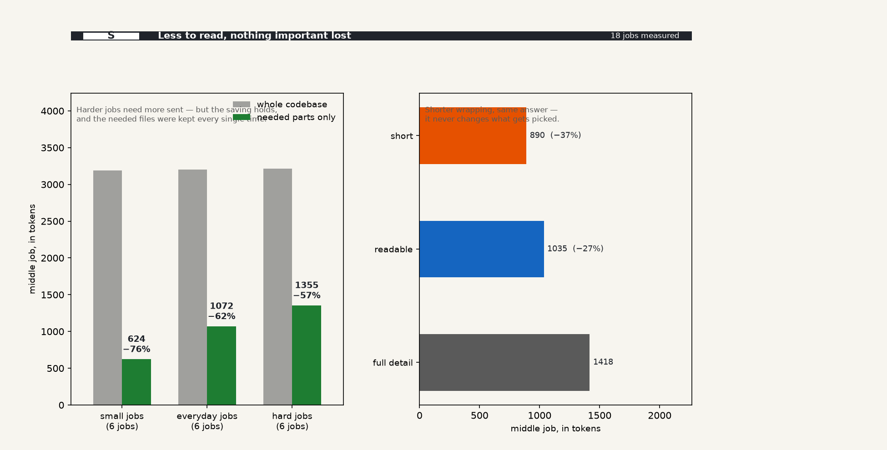

# ane-context-harness

[English](README.md) · [Tiếng Việt](README.vi.md) · [中文](README.zh.md) · [Français](README.fr.md) · [Español](README.es.md) · [日本語](README.ja.md) · [한국어](README.ko.md)

> **Send the evidence, not the repo — and know exactly what you didn't send.**

Given a repo, a task, and a token budget, ane-harness returns the evidence that fits — named evidence first — never sends more than the budget allows, counts whatever didn't fit, and hands your agent a ready-to-run search command when something is missing.

[](https://github.com/ericlam2k/ane-context-harness/actions/workflows/ci.yml)
[](https://python.org)
[]()
[]()

---

## What it does (10 seconds)

Your coding agent reads more of your repo than it needs, every turn. The provider bills you for every token of that context, reused or not — so sending everything works, and costs you for distractors forever.

ane-context-harness sits between your repo and your agent. It indexes the repo once, and per task it picks the few pieces of code the task needs, packed to fit the token budget you set. It never sends more than you asked for, it keeps an exact count of what didn't fit, and when something required was missed it prints a search command your agent can run to find it.

The name `ane` is historical; it is **not** a dependency. The shipped engine is pure Python plus SQLite, runs the same on macOS, Linux, and Windows, and needs no special hardware.

## Install (30 seconds)

Requires Python 3.11 or newer.

```bash
git clone https://github.com/ericlam2k/ane-context-harness.git
cd ane-context-harness
pip install -e .
ane-harness health
```

`health` prints a short status report; `"status": "ok"` means the engine is up.

```bash
# index the repo, install the agent skill, smoke-test — one command
ane-harness setup --repo /path/to/your/project --repo-id my-project --yes

# ask for the evidence for one task
ane-harness select \
  --repo-id my-project \
  --task "Fix the discount calculation bug in checkout" \
  --budget 1200
```

To check the numbers on your own repo (unlabelled — reports median reduction and latency, never a recall claim without your labelled tasks):

```bash
ane-harness prove --repo /path/to/your/project --repo-id my-project
```

## See it work

Real output (trimmed) from a tiny 4-file billing demo, the task "Fix the discount calculation bug in checkout", and a deliberately tight 80-token budget — too small to pack the file the task points at:

```json
{
  "metrics": {
    "candidate_tokens": 193,
    "selected_tokens": 69,
    "reduction_percent": 64.25,
    "diagnostics": {
      "claims_dropped_budget": 1,
      "recovery": {
        "required_claims_total": 1,
        "required_claims_covered": 0,
        "missed_claims": [
          {
            "path": "src/billing/discount.py",
            "why": "budget",
            "command": "rg -n 'apply_discount|calculate_discount' -- 'src/billing/discount.py'"
          }
        ]
      },
      "recovery_prompt": "Evidence below may be incomplete: the pack missed 1 required claim (src/billing/discount.py (budget)). ..."
    }
  }
}
```

And the line on stderr after every run:

```
ane-harness: LOCAL est. pack 0.1k from est. 0.2k eligible · est. cut 64.25% · 3 chunks · 37 ms · cpu_deterministic · ask: re-select with --stated-symbol if evidence misses
```

stdout stays pure JSON (the `summary` key carries the same line over MCP), so scripts never break. The footer is a **local estimate** from the pinned counter, not a bill — for a provider-counted with/without proof against a free model, see `ane-harness meter`. The important part of the story: the pack did not fit the file the task named, so the harness said so — exact counts, the reason, and the search command to find the missing file — instead of quietly handing over half the answer.

## How the pack is chosen

One rule does almost all the work: the pack fills in passes, in this order — **claims → breadth → depth → tail**.

1. **Claims** — evidence the task itself points at: a symbol or path named in the task, or the matching test file when the task asks about tests. Admitted first, in score order, while it fits.
2. **Breadth** — the best chunk of each remaining file, one file's best chunk before a second chunk of any other file.
3. **Depth** — further chunks, in score order.
4. **Tail** — a small reserved slice of the budget for small, high-value chunks crowded out of the core.

```
Your Codebase                          Your Prompt
      │                                     │
      ▼                                     ▼
 index once                          extract claim terms
 (SQLite, local)                             │
      │                                     ▼
      └────────────►  Claims → Breadth → Depth → Tail
                               │
                               ▼
                     pack within budget
                  (chunks admitted whole
                   or not at all — never
                   rewritten to fit)
```

Two rules keep the promise. Only what you pin explicitly (`--explicit-path` or an authority rule) may push the pack past the requested budget; inferred evidence never can. And anything that did not fit is counted in the output — never hidden. Pinned files travel byte-exact; nothing is truncated, summarized, or rewritten to fit — only noisy log/tool output is collapsed, and per-file routing is in `diagnostics.routing`. Details and all diagnostics keys: [docs/recovery.md](docs/recovery.md).

## When evidence doesn't fit

- The pack never silently drops things. What didn't fit is counted — `claims_dropped_budget`, `claims_capped`, and friends under `metrics.diagnostics`.
- When required evidence missed, the output carries a `recovery` block: up to five missed items with path, symbol, *why* (`budget` / `capped` / `dropped`), and a ready-to-run search command (`rg -n`, or a `grep -nE` equivalent). Printed, never run.
- Hints fire only on evidence the task requires — never on discretionary cuts. A hint is where to look next, not a promise the pack is complete.

Stated needs — when the task text is not enough:

- `--stated-symbol` (repeatable) and `--stated-need "free text"` state what you need directly. Resolution is an index lookup at zero model cost.
- Resolved items are admitted under the same budget rules — there is no override and no bypass. Unresolved items are never packed; they are reported with the nearest indexed symbols to try.
- The ask (`recovery_prompt`) appears only when something is missing or a stated item did not resolve — never as decoration. Example from the run above: the footer's `ask:` clause appeared exactly because a required claim was cut.

Full detail, the need-text gate, and aim accounting: [docs/recovery.md](docs/recovery.md).

## Proof: what we measured, and what we did not

**What we have measured is the payload — how many tokens the pack holds, and what is in it. We have not measured outcome evidence (whether the agent finishes the task), and no number in this section stands in for that.**

Frozen benchmark table — 18 evaluation tasks from our frozen split (`benchmarks/splits.json`, seed `20261002`), synthetic Python and TypeScript fixtures. We tuned on this set while developing, so treat these figures as a regression check, not an independent estimate of how the tool generalises:

| Metric (evaluation split, n = 18) | Send everything | ane-harness |
|---|---|---|
| Median tokens sent to the model | 3,213 | **782** |
| Median reduction | — | **63.1%** (local estimate, not a bill) |
| Required-evidence recall (min over tasks) | 1.0 (it sends everything) | **1.0** |

How to read the chart: by job size, grey bars are what you would send if you sent the whole codebase, green bars are what the harness picked — and the needed files were kept every time. The right panel shows the same selection in three wrappings; shorter is cheaper, and the wrapping never changes what gets picked.



The measured comparison against outside tools, on the same 18 jobs with the same token counter: sending everything (median 3,213) covers everything by definition — it sends everything. We measured two outside tools (`headroom-ai 0.39.1`, `toon-format 1.0.0`). Under the same stricter gate ours is held to (the exact required chunk must appear), the rewrite tool's median pack was 3,633 tokens — more than sending everything — and it lost a config file the grader required on 1 of 18 jobs; its rewrite was checked by symbol/path presence, a looser check than ours, and both results are reported side by side, never merged. The TOON format encoded our selection at a median 1,134 tokens vs our compact wrapping at 890. We measured two tools; we claim nothing about any other. Details: `benchmarks/reports/same-exercise-bench.json`.

Agents rarely ask one question. A 3-turn conversation replayed over 18 jobs: re-sending everything every turn costs 149,490 tokens; carrying the pack forward costs 51,940 — and recall stayed 1.0 on all 54 turns. Boundary, stated plainly: no model reads these packs, the follow-ups are fixed strings, and nothing is billed. It measures the half this harness controls — the picking and carrying — not the loop. Details: `benchmarks/reports/conversation-bench-eval.json`.

Reproduce every figure above: see [Reproduce the numbers](#reproduce-the-numbers). The fastest single check is on your own repo:

```bash
ane-harness prove --repo /path/to/your/project --repo-id my-project
```

## Limits: what this is not

- **Redaction is best-effort.** The harness scans for common secret shapes and filename patterns and replaces them with placeholders; it does not guarantee every secret is caught, and the `update`/`proxy` commands print that on every run. Never rely on it as your only secret control.
- **The harness controls only the evidence pack.** Your agent still bills for its system prompt, tool definitions, and conversation history — overhead this harness cannot trim. Packing less does not shrink those.
- **Cost figures derived from token counts are estimates, not bills.** The local counter is pinned (`TOKEN_ESTIMATOR_VERSION = "2"`) so counts are reproducible, but your actual bill depends on your provider's caching and tokenization. The core never reads tiktoken, even when it is installed — counting is regex-based and built in. `ane-harness meter` can measure provider-counted input on a free model; it makes a live network call and is refused for paid models.
- **Latency is host-dependent.** Selection time printed by the tool is wall-clock on one machine; it is not a guarantee about yours.

## Use it with your agent

> **Agents: do not run `serve` or `mcp` inside an agent turn.** Both never exit — a tool call that launches one blocks forever, so the turn never completes. Bare `update`/`proxy` on an interactive terminal exits 2 with a hint instead of waiting on stdin. Inside agent turns use one-shot commands (`index`, `select`, `prove`, `daily`, `health`). Run the server detached from a real terminal (`nohup ane-harness serve --port 8765 &`), or not at all.

**CLI.** `index` · `select` · `prove` · `update` (batch a JSONL file of tasks; illustrative sample below) · `proxy` (stdin in, Markdown out) · `daily` · `health` · `meter` (provider-counted with/without proof, free models only). All print JSON on stdout; footers go to stderr.

```text
# ane-harness update — ILLUSTRATIVE SAMPLE, not measured output:
repo_id: my-project | tasks: 3 | budget: 2000
  Fix the discount calculation      before 3189 → after 1952
  debug the inventory loader        before 3189 → after 1758
  review reporting stats output     before 3189 → after 1261
TOTAL: before 9567 → after 4971 tokens (median reduction 44.87%, local estimate)
```

**HTTP API.** `ane-harness serve --port 8765`, then:

- `GET  /v1/health` — status, compute mode, profiles
- `POST /v1/repositories/index` — index or update a repository
- `POST /v1/context/select` — Retrieve optimized context for a task
- `POST /v1/context/compress-output` — Compress verbose test/build logs into failure digests

**MCP.** Optional; requires the extra: `pip install 'ane-context-harness[mcp]'`, then `ane-harness mcp` (stdio by default; `--transport sse` also available). The same warning as above applies — MCP never exits on its own.

**Python.**

```python
from ane_context_harness.config import build_config
from ane_context_harness.pipeline import Pipeline
from ane_context_harness.schemas import SelectRequest
from ane_context_harness.providers import serialize

cfg = build_config()
pipeline = Pipeline(cfg)
pipeline.register_repository("/path/to/my-repo", repo_id="my-repo")

request = SelectRequest(
    repository_id="my-repo",
    task="Update loyalty point rounding logic in payment service",
    token_budget=1500,
)
package = pipeline.select_context(request)

anthropic_payload = serialize("anthropic", package)
openai_payload    = serialize("openai", package)
markdown_text     = serialize("markdown", package)
```

Adapters serialize the pack for Anthropic Messages (with prompt-caching breakpoints), OpenAI Responses, OpenAI-compatible chat, and Markdown. Serialization is **format-only** — no adapter makes network calls; `meter` is the only command that talks to a provider.

**Proxy.** Pipe tasks on stdin, get Markdown back — no skill, MCP, or HTTP needed:

```bash
printf '%s\n' '{"task": "Fix the discount bug"}' 'review inventory loader' \
  | ane-harness proxy --repo /path/to/your/project --repo-id my-project --budget 2000 \
  > context.md
```

**Skill.** The bundled skill at `skills/ane-harness/SKILL.md` makes cut totals surface after each task in compatible hosts. Copy it into your agent's skills directory, or — for OpenCode/Claude-compatible hosts — use `~/.config/opencode/skills/`, `~/.claude/skills/`, or `~/.agents/skills/`; new sessions pick it up with no per-project setup. Disable the local ledger any time with `ANE_HARNESS_NO_USAGE_LOG=1`.

## Reproduce the numbers

Everything above comes from committed scripts and reports; nothing is hand-picked. The short list (full detail, first-use definitions of required-evidence recall, recall@k, nDCG, and MRR: [docs/reproducibility.md](docs/reproducibility.md)):

```bash
# token savings table + chart (rewrites the committed report)
PYTHONPATH=src python3 scripts/measure_token_savings.py
PYTHONPATH=src python3 scripts/plot_token_savings.py

# same-exercise comparison vs outside tools (installs needed)
pip install headroom-ai toon-format
PYTHONPATH=src python3 scripts/bench_same_exercise.py

# 3-turn conversation bench
PYTHONPATH=src python3 scripts/bench_conversation.py

# release evidence bundle checksums
ane-harness evidence verify ane-context-harness-evidence-v0.1

# the test suite (needs: pip install -e .[test])
python3 -m pytest -q
```

The evaluation split (18 tasks) was exposed during tuning — it is a regression set, not an untouched test. Ranking-quality figures (nDCG@10 ≈ 0.849, MRR ≈ 0.907 — how close the emission order is to ideal) live in `benchmarks/reports/ranking_fusion.json` and are explained in [docs/reproducibility.md](docs/reproducibility.md); they compare ranking strategies, not outcomes. Outcome evidence does not exist yet.

## Docs

- [docs/recovery.md](docs/recovery.md) — recovery hints, stated needs, the ask, the need-text gate, aim accounting
- [docs/reproducibility.md](docs/reproducibility.md) — metric definitions, reproduce commands, evidence bundles
- [docs/adr-002-embedding-go-no-go.md](docs/adr-002-embedding-go-no-go.md) — why embeddings are out (for now)
- [docs/provider-evaluation-stages.md](docs/provider-evaluation-stages.md) — provider adapter roadmap and spend limits
- [docs/deprecation-policy.md](docs/deprecation-policy.md) — compatibility and removal policy
- [CHANGELOG.md](CHANGELOG.md) — release history
- [benchmarks/reports/README.md](benchmarks/reports/README.md) — how the reports are labelled and aggregated

## License

MIT License. Designed for local intelligence, developer privacy, and sane token budgets.
