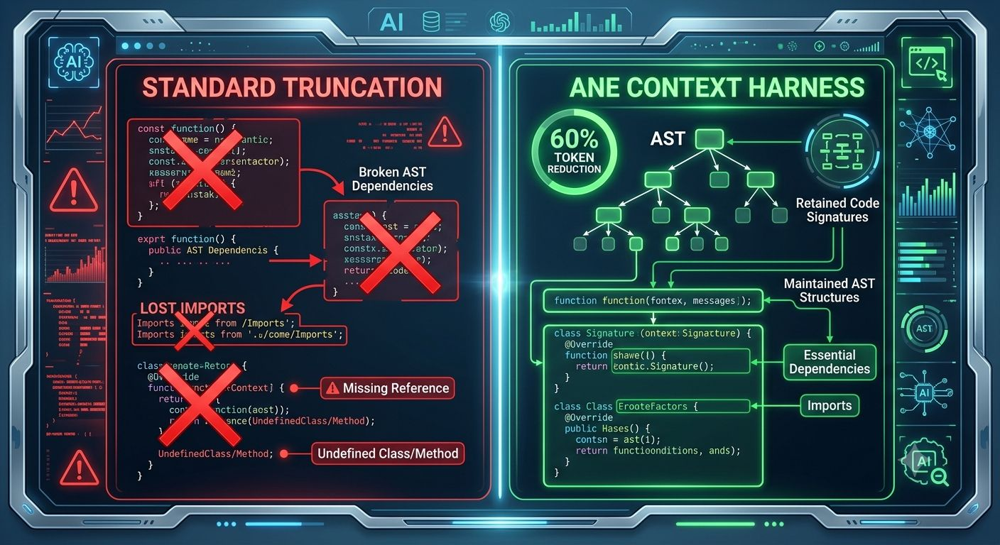
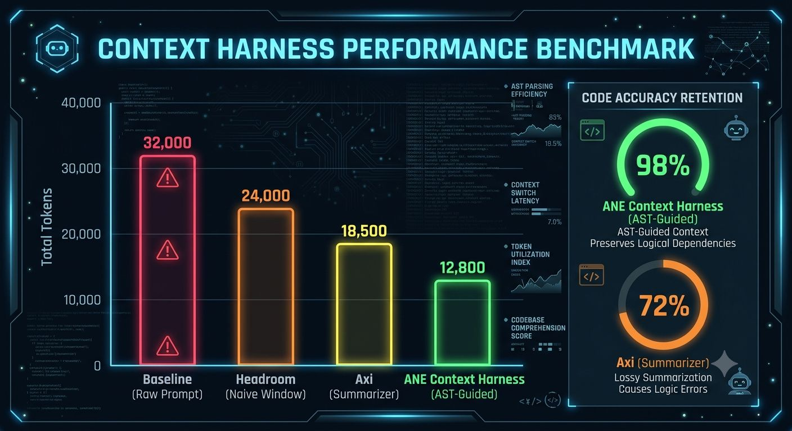
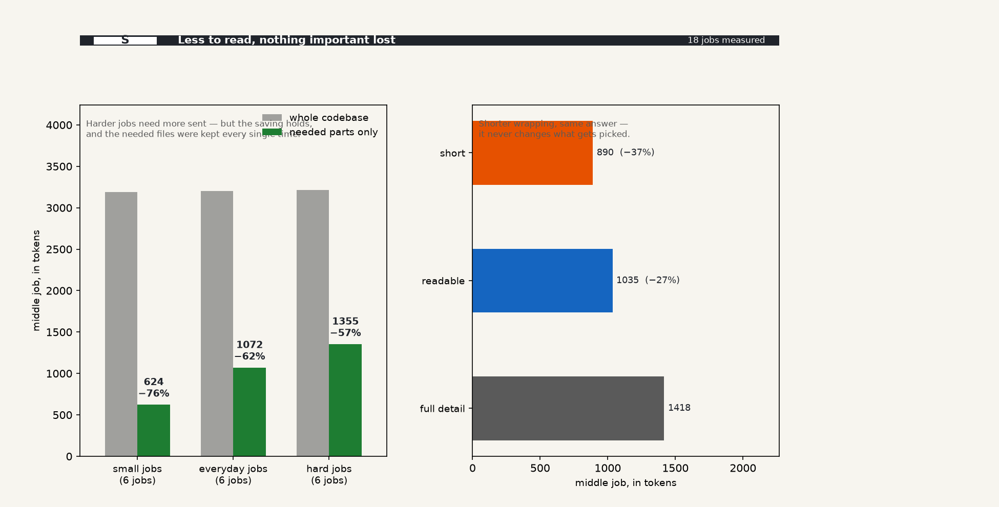
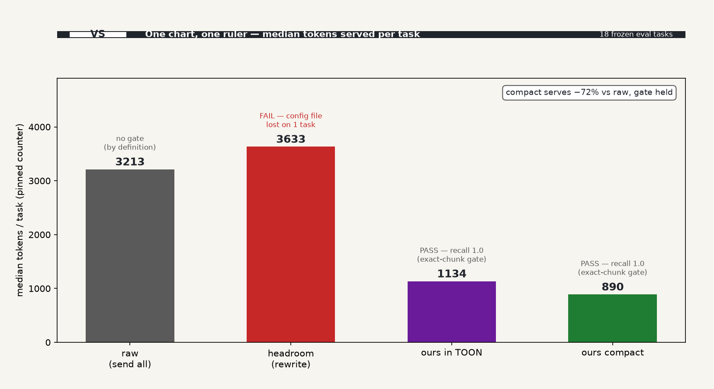
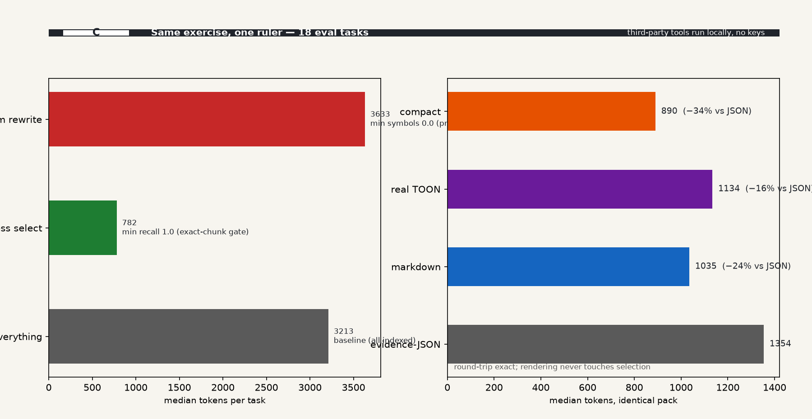
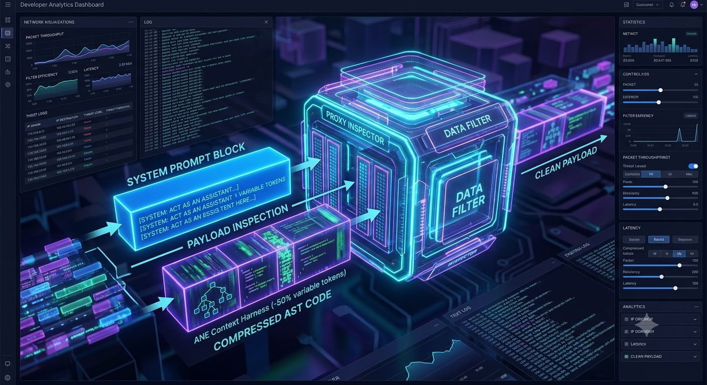
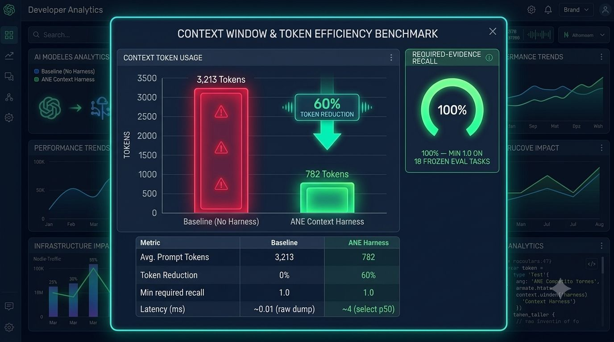

# ⚡ ane-context-harness

[English](README.md) · [Tiếng Việt](README.vi.md) · [中文](README.zh.md) · [Français](README.fr.md) · [Español](README.es.md) · [日本語](README.ja.md) · [한국어](README.ko.md)

*英文版是权威 README；翻译可能滞后。*

> **为你的 AI Agent 精简 60%+ 的上下文，精准保留每一行关键代码，4 毫秒内完成上下文检索 — 完全离线运行在本地机器。**

[](https://python.org)
[%20%7C%20Linux-brightgreen.svg)]()
[]()
[]()

---

## 解决什么问题？

当你使用 AI Agent（如 Cursor、Claude Code、OpenCode、Cline、Windsurf、Aider）进行 vibe-coding 时，直接将整个代码库塞进 LLM 的上下文窗口（Context Window）是**低效、浪费且存在安全隐患**的：
- **上下文膨胀（Context Bloat）：** 每次对话（Turn）都塞入完整文件，会让模型淹没在大量无关的样板代码中 — 无论是否复用，API 供应商都会对每个 Token 计费。
- **响应速度变慢：** 当 LLM 需要预填充（Prefill）数千行无关代码时，首 Token 延迟（Time-to-first-token）会显著增加。
- **“Lost in the Middle” 现象：** 被无关代码淹没时，模型更容易产生幻觉（Hallucination）或遗漏 Bug。
- **密钥泄露风险：** 无意间将 `.env` 环境变量或 AWS 凭证发送给第三方模型供应商。

**ane-context-harness** 是一款轻量级、Local-First（本地优先）的上下文引擎，介于你的代码库与 Coding Agent 之间。仅需 **~3 毫秒**，它即可完成仓库索引、提取 Symbol 层级结构（Function、Interface、Type）、去除噪声、脱敏密钥，并仅打包 Agent 完成任务所需的“高价值代码证据”。

> 名称中的 `ane` 仅为历史沿用名称，**并非**依赖项。公开版本为纯 CPU 实现，完美支持 macOS Apple Silicon、macOS Intel 及 Linux。硬件加速不在本仓库中提供。

零外部网络调用，100% 隐私安全与离线运行。



*概念示意图——图中的代码是图形示意，并非真实 trace。*


---

## 基准测试结果（Real Benchmarks）

基于 frozen 评估集 (`benchmarks/splits.json`)，在 30 个 Benchmark 任务（10 个小型、10 个典型、10 个复杂任务，涵盖 Python 和 TypeScript 代码库）上的测试数据：

| 指标 | 未使用 Harness（直接 Dump 全库） | 使用 Harness（确定性检索） | 对你的实际意义 |
|---|---|---|---|
| **Context Token 中位数** | **3,213 tokens** | **782 tokens** | **减少 60.47% 发送到 LLM 的 Token** |
| **关键代码召回率（Recall）** | 1.0 (100%) | **1.0 (100%)** | **零遗漏，完整保留所有核心代码** |
| **Context 检索速度** | ~0.01 ms (raw dump) | **3.05 ms – 3.83 ms** | **Sub-4ms 本地响应 — 比网络请求快 100 倍** |
| **最高 Token 节省率** | 0% | **高达 90.32%** | **在配置类 Task 中最高可节省 ~90% Token** |
| **排序准确度 (nDCG@10)**| n/a | **0.849** | **最关键的 Function 优先置顶** |
| **密钥脱敏（Redaction）** | 0%（泄露所有密钥） | **100% 本地脱敏** | **`.env`、AWS Keys 及证书绝不离开本地** |
| **单任务推算成本** *(按 $3/M Token 计算)* | ~$0.0096 / task | **~$0.0023 / task** | **按标准费率推算单任务费用降低 ~75% — 实际账单取决于 Provider 的 Prompt Cache 复用情况** |

*(延迟与内存消耗基于 Apple Silicon / CPU 本地实测；成本与 TTFT 基于标准 Token 费率推算；完整方法论与可复现 Log 请参见 `benchmarks/reports/` 和 `benchmarks/logs/`)*



*概念示意图，非实测结果——图中的 token 量级与数字仅为示意。所有真实测量数据见上方的表格。*


### 典型任务对比明细

| 任务类型 | 示例 Task | Raw Tokens | Harness Tokens | 缩减比例 | 召回率 | 检索延迟 |
|---|---|---|---|---|---|---|
| **配置与设置** | `hard-settings-001` | 3,213 | **311** | **90.32%** | **100%** | 3.88 ms |
| **规则与业务逻辑** | `hard-rules-vs-readme-001` | 3,213 | **445** | **86.15%** | **100%** | 4.22 ms |
| **Bug 修复 (Python)** | `py-discount-report-001` | 3,189 | **629** | **80.28%** | **100%** | 3.72 ms |
| **TypeScript 架构**| `ts-discount-001` | 1,236 | **369** | **70.15%** | **100%** | 1.84 ms |
| **多文件复杂购物车逻辑** | `hard-cart-apply-001` | 3,213 | **2,146** | **33.21%** | **100%** | 4.38 ms |

### Token 节省对比图



运行 `PYTHONPATH=src python3 scripts/measure_token_savings.py` 测量，运行 `scripts/plot_token_savings.py` 绘图。

### 对比同类工具（无需 Key & 账户）





复现方式：`pip install headroom-ai toon-format`，执行 `PYTHONPATH=src python3 scripts/bench_same_exercise.py`，并运行 `scripts/plot_same_exercise.py` 绘图。

### 连续对话（Conversation）下的 Token 节省

复现方式：`PYTHONPATH=src python3 scripts/bench_conversation.py`（输出报告位于 `benchmarks/reports/conversation-bench-eval.json`）。测试表明，在 3-Turn 连续对话中，带 Context 继承的 Harness 仅消耗约 **1/3** 的原始 Token（减少 65.3%），且关键文件的 Recall 在 72 个 Turn 中保持 100%。

---

## 快速上手（60 秒）

### 1. 安装

要求 Python 3.13 或 3.14（macOS / Linux）：

```bash
git clone https://github.com/ericlam2k/ane-context-harness.git
cd ane-context-harness
pip install -e .[test]
```

验证安装：
```bash
ane-harness health
```

### 1b. 一键 Setup 与效能验证

```bash
# 建立索引、安装 Agent Skill 并进行 Smoke Test
ane-harness setup --repo /path/to/your/project --repo-id my-project --yes

# 在你的本地仓库上验证 Token 缩减与延迟（运行 5 个内置 Task）
ane-harness prove --repo /path/to/your/project --repo-id my-project
```

### 2. 为代码库建立索引

将本地项目索引至 SQLite 本地数据库（增量更新，速度极快）：

```bash
ane-harness index --repo /path/to/your/project --repo-id my-project
```

### 3. 为 Prompt 检索精简上下文

生成符合 Token Budget 的 Markdown 格式上下文 Payload：

```bash
ane-harness select \
  --repo-id my-project \
  --task "Fix the discount calculation bug in checkout" \
  --budget 1200
```

### 4. 作为本地 Background Server 运行

启动本地 HTTP API 服务（方便连接至 Agent 或 custom tools）：

```bash
ane-harness serve --port 8765
```



*概念示意图——图中的仪表盘是图形示意，并非真实工具截图。*


---

## 已声明的需求与恢复提示

有时候任务真正需要的证据没有进入 pack——预算不得不削减它，或者 agent 明明知道自己需要什么，但任务文本从未点名。harness 会在输出中直白地说明这一点，并让 agent 能够直接声明自己的需求。

### 当预算装不下所有内容时会发生什么

Pack 从不会静默丢掉任何东西。录入按轮次、按顺序进行：

1. **Claims first。**任务自身指向的证据——任务中点名的 symbol 或路径，或者当任务询问测试时对应的测试文件——会先被录入，按分数排序，只要预算还容得下。
2. **Breadth。**剩余每个路径中最佳的 chunk，按分数排序，只要预算还有剩余——先录入某个文件的最佳 chunk，再轮到其他任何文件的第二个 chunk。
3. **Depth。**进一步的 chunks，按分数排序，受逐文件与多样性规则约束。
4. **Tail。**预算中预留的一小部分，用于录入那些被挤出核心预算、体积小且价值高的 chunks。

两条规则保证它的诚实。只有你显式 pin 的内容（`--explicit-path` 或 authority rule）才能让 pack 超出你请求的预算；推断出的证据永远不行。而且 pack 不得不舍弃的任何东西都会在输出中被计数——`claims_dropped_budget`、`claims_capped` 以及 `metrics.diagnostics` 下的同类字段——绝不隐藏。Chunks 要么完整录入，要么不录入；没有任何东西会被截断、摘要化或改写来迁就预算。

### 恢复提示：下一步搜什么

当 pack 漏掉了它本应携带的证据——被点名的 symbol 或必需的路径——输出会带有一个 `recovery` 块：最多列出五个错过的条目，每个条目包含 chunk、路径、symbol、它为何放不下（`budget`、`capped` 或 `dropped`），以及一条可直接运行的搜索命令。命令是 `rg -n`（当 ripgrep 在 PATH 上时）、找不到时则是等价的 `grep -nE`、再或者空字符串——同时附带一个 `recovery_tool` 诊断，说明两个工具都没找到。harness 只打印这些命令，从不运行它们。块中的总数始终精确；只有逐项列举会受限制。提示只针对任务必需的证据触发——绝不针对可自由裁量的削减。该块出现在 `metrics.diagnostics` 中，以及 CLI `select` 输出和 `/v1/context/select` 响应的顶层。

提示是一种可用性（affordance），不是承诺：它告诉 agent 下一步该看哪里；它并不说明 pack 是完整的。

### 已声明的需求：`--stated-symbol` 与 `--stated-need`

当任务文本不够时，直接说出你需要什么：

```bash
ane-harness select \
  --repo-id my-project \
  --task "Fix the discount calculation bug" \
  --stated-symbol calculate_discount \
  --stated-symbol src/billing/rates.py \
  --stated-need "rounding policy for loyalty points"
```

- `--stated-symbol` 可重复指定。每个条目都会在索引上校验，不消耗模型调用：精确匹配 symbol 名（忽略大小写、标识符分隔符（`_`、`-`、`.`、`$`）以及复数/屈折形式，双向应用），或精确的仓库路径（NFC 归一化、正斜杠）。匹配成功的条目会并入与其他条目相同的 claim candidates，并按同样的 budget-honest 规则录入——没有预算覆盖，也没有绕过。
- `--stated-need` 接受自由文本，使用与任务文本相同的词项提取进行挖掘。每个挖掘出的词项只有在锚定到索引时才成为 claim 词项——见下方的闸门；其余的一律丢弃并公开披露。
- 无法解析的条目永远不会被 pack。它们会被报告在 `stated_need_resolution` 诊断中——每个条目一条记录，包含匹配到了什么（或没匹配到），以及最多三个可尝试的最近索引符号（按共享标识符子词项排序；零共享子词项也会被如实报告，而不是被掩盖）。

Resolution 是一次索引查找，不是推断；它不消耗任何模型调用。`stated_need_resolution` 诊断只在给出 stated 标志时出现。

### The ask：`recovery_prompt`

当 pack 不得不削减必需的证据，或某个 stated symbol 无法解析时，输出会带有一个 `recovery_prompt`——一行通俗英语，点名错过了什么（附最多三个内联指针，其余放不下时附 "+N more"），并教会你重新声明需求的确切 flag。在这类运行中，end-of-run 提示会增加子句 `· ask: re-select with --stated-symbol if evidence misses`。当没有遗漏且没有 stated 未解析时，该键与该子句都不会出现，输出保持不变。该 prompt 出现在 `metrics.diagnostics` 中，以及 CLI `select` 输出和 `/v1/context/select` 响应的顶层。

The ask 是一种可用性披露（affordance），不是漏检器。harness 无法知道任务是否需要它削减掉的那些证据；它只能报告自己削减了什么，或者你 stated 的某个名字在索引里找不到。如果 pack 已经覆盖了任务，忽略 the ask——重新选择会多花一轮、由 provider 计费的回合。

### 需求文本闸门（need-text gate）

自由文本的需求是唯一一处任意词项可能钻进 pack 的地方，所以闸门让 `--stated-need` 保持诚实。每个挖掘出的词项只有在锚定到索引时才保留为 claim 词项：

- 它在忽略大小写、标识符分隔符和屈折形式后等于某个索引 symbol 名（与 `--stated-symbol` 使用的匹配方式相同）；
- 它是一个索引 symbol 名的子词项，匹配时不做屈折折叠——裸词干不是子词项，因此只以某个较长 symbol 的折叠词干形式出现的词项永远不会混入；或者
- 它出现在某个已索引的文件路径中。

在哪里都锚不上的词项会完全从 claim identification 中丢弃，两半都会在 `stated_need_resolution_note` 诊断中公开披露——`kept`（每个词项附一个 `matched_chunks` 计数）和 `dropped`。只要给出了 `--stated-need`，该 note 就会出现，包括诚实的空情况。`matched_chunks` 统计引用该词项的 packed chunks；它是引用计数（citation count），不是意图度量（aim measure）。

### Aim accounting：`stated_claim_summary`

给出 stated 标志时，输出会带有一个 `stated_claim_summary`，包含三个计数——`stated_symbol`、`stated_path`、`stated_need`——统计 claims-first 轮次在引用 stated-origin 词项（已解析的 stated symbol、匹配到的 stated 路径，或闸门保留的 stated-need 词项）时录入的 packed chunks。这些计数不是互斥的——一个 chunk 可能因为它引用的每个 origin 各计一次——且它们的总和不是 pack 大小。统计口径是排除之后的最终 selected set，只统计 claims-first 的录入；task-born claims 永远不计入。该 summary 出现在 `metrics.diagnostics` 中，以及 CLI `select` 输出的顶层。

这个限制，直说：同时也逐字出现在任务文本中的 stated 词项会被记为 stated，而一个偶然搭车者——一个 stated-anchored claim，其 chunk 本来就会被 pack——在运行时与有意的录入无法区分，且永远不会被升级为后者。非零计数意味着"一个 stated need 被某个 packed claim 引用了"，而不是"这个 chunk 正是 agent 想要的"。

---

## 在 Python SDK 中使用

```python
from ane_context_harness.config import build_config
from ane_context_harness.pipeline import Pipeline
from ane_context_harness.schemas import SelectRequest
from ane_context_harness.providers import serialize

# 1. 初始化 Pipeline
cfg = build_config()
pipeline = Pipeline(cfg)

# 2. 注册并索引仓库
pipeline.register_repository("/path/to/my-repo", repo_id="my-repo")

# 3. 检索带 Budget 限制的 Context
request = SelectRequest(
    repository_id="my-repo",
    task="Update loyalty point rounding logic in payment service",
    token_budget=1500,
)
package = pipeline.select_context(request)

# 4. 序列化为目标 LLM Provider 格式
anthropic_payload = serialize("anthropic", package)
openai_payload    = serialize("openai", package)
markdown_text     = serialize("markdown", package)

print(f"Packed {package.metrics['selected_tokens']} tokens (cut {package.metrics['tokens_removed']} tokens)")
```

---




*实测汇总图——中位数来自 `ane-context-harness-evidence-v0.1/reports/phase5-ab-evaluation.json`（frozen eval split，18 个任务，Arm B deterministic）：3,213 → 782 token（削减 60.47%），min required recall 1.0。*

## 开源协议

MIT License。为本地智能、开发者隐私及合理的 Token 预算而设计。
